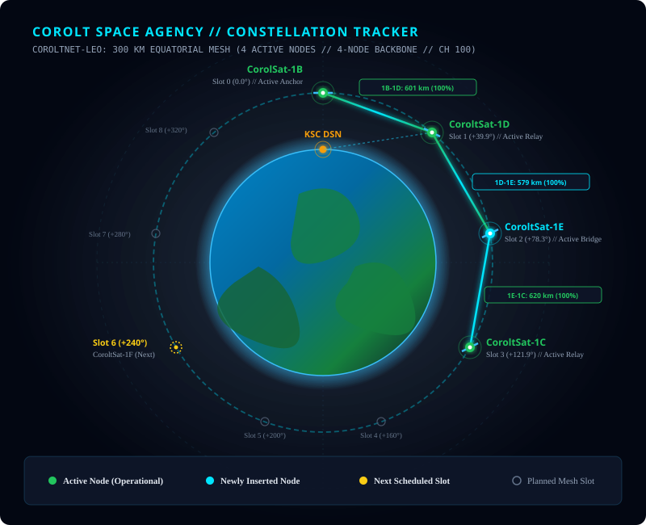

# 🌐 CoroltNet-LEO: Equatorial Satellite Constellation

The **CoroltNet-LEO** system is the flagship orbital telecommunications and science relay infrastructure of the Corolt Space Agency (CSA). Operating in a circular Low Kerbin Orbit (LEO) at **$300\text{ km}$ altitude**, the network provides continuous, low-latency, inter-satellite cross-links and direct high-bandwidth communications to the Kerbal Space Center (KSC) and planetary ground stations.

---

## 🛰️ Orbital Architecture & Live Constellation Map

---

## 📊 Live Node Fleet Specifications

| Spacecraft | Launch Mission | Status | Altitude ($Ap \times Pe$) | Orbital Period | Relative Phase | Relay Antenna | CommNet Channel |
| :--- | :--- | :--- | :--- | :--- | :--- | :--- | :--- |
| **CorolSat-1B** | [CSA-12](/missions/csa-12) | 🟢 **ACTIVE** | $311.5 \times 300.0\text{ km}$ | $2,882.09\text{ s}$ ($48.03\text{ min}$) | $0.0^\circ$ (Reference) | Codac-A23 ($650\text{ km}$ Relay) | `CoroltSat-LEO` (100) |
| **CoroltSat-1C** | [CSA-13](/missions/csa-13) | 🟢 **ACTIVE** | $308.8 \times 302.7\text{ km}$ | $2,881.92\text{ s}$ ($48.03\text{ min}$) | $+20.6^\circ$ ($+323\text{ km}$) | Codac-A23 ($650\text{ km}$ Relay) | `CoroltSat-LEO` (100) |
| **CoroltSat-1D** | *CSA-14 (Upcoming)* | 🟡 **ASSEMBLY** | $300.0 \times 300.0\text{ km}$ *(Target)* | $2,882.1\text{ s}$ *(Target)* | $+40.0^\circ$ (Slot 1) | Dedicated High-Gain Relay | `CoroltSat-LEO` (100) |
| **CoroltSat-1E** | *CSA-15 (Planned)* | ⚪ **PLANNED** | $300.0 \times 300.0\text{ km}$ *(Target)* | $2,882.1\text{ s}$ *(Target)* | $+240.0^\circ$ (Slot 6) | Dedicated High-Gain Relay | `CoroltSat-LEO` (100) |

---

## 📐 Constellation Geometry & Line-of-Sight Physics

### 1. Inter-Satellite Range vs. Antenna Power ($40.0^\circ$ Mesh Spacing)
In a circular orbit with radius $R_{\text{orb}} = R_{\text{Kerbin}} + h = 600\text{ km} + 301\text{ km} = 901\text{ km}$, the Euclidean line-of-sight distance (chord length $d$) between two nodes separated by an angular distance $\Delta \theta$ is:

$$d = 2 \cdot R_{\text{orb}} \cdot \sin\left(\frac{\Delta \theta}{2}\right)$$

For the nominal constellation design spacing ($\Delta \theta = 40.0^\circ$):

$$d = 2 \cdot 901\text{ km} \cdot \sin(20.0^\circ) = 1,802\text{ km} \cdot 0.34202 = \mathbf{616.4\text{ km}}$$

Because the effective relay power of the Codac-A23 omnidirectional relay is **$650.0\text{ km}$**:

$$\mathbf{616.4\text{ km} < 650.0\text{ km} \quad \Longrightarrow \quad 100\% \text{ Inter-Satellite Link Margin}}$$

Adjacent nodes maintain permanent direct microwave cross-links without requiring directional dish tracking.

### 2. Horizon Clearance & Planetary Occlusion
Kerbin has an equatorial radius of $R_{\text{Kerbin}} = 600\text{ km}$. From a $301\text{ km}$ orbital altitude, the maximum angular line-of-sight horizon before the planetary sphere occludes the signal is:

$$\alpha = \arccos\left(\frac{R_{\text{Kerbin}}}{R_{\text{orb}}}\right) = \arccos\left(\frac{600}{901}\right) \approx 48.2^\circ$$

$$\Delta \theta_{\max} = 2 \alpha \approx \mathbf{96.4^\circ}$$

At $\Delta \theta = 40.0^\circ$, the inter-satellite line of sight passes **$246\text{ km}$ above Kerbin's surface**, well outside the exosphere ($70\text{ km}$), completely eliminating atmospheric plasma degradation or terrain shadowing.

### 3. Interleaved Deployment Strategy
To guarantee immediate mission utility while the full 9-node ring is assembled:
1. **Phase 1 (Equatorial Triangulation)**: Nodes at $0.0^\circ$ (`1B`), $+120.0^\circ$, and $+240.0^\circ$ provide global ground station coverage to every sector of Kerbin.
2. **Phase 2 (Mesh Ring Closure)**: Subsequent launches fill the $40.0^\circ$ intervals ($+40.0^\circ, +80.0^\circ, +160.0^\circ, +200^\circ, +280^\circ, +320^\circ$) to establish the continuous closed-loop relay mesh ring.

---

## 🛠️ Ground Station Network Integration (DSN)

* **Primary DSN Hub**: Kerbal Space Center (KSC) — $\text{Lat } 0.0^\circ, \text{Lon } 0.0^\circ$
* **Frequency Tuning**: Frequency Channel `100` (`CoroltSat-LEO` profile in CommNet Constellation)
* **Redundancy Protocol**: Ground station tracking automated via CommNet Constellation scenario routing. When line-of-sight to KSC is lost on the night-side hemisphere, signals hop across adjacent nodes to route science telemetry back to Mission Control in real time.
