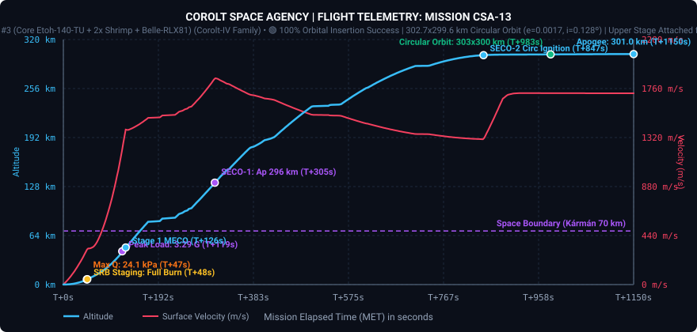
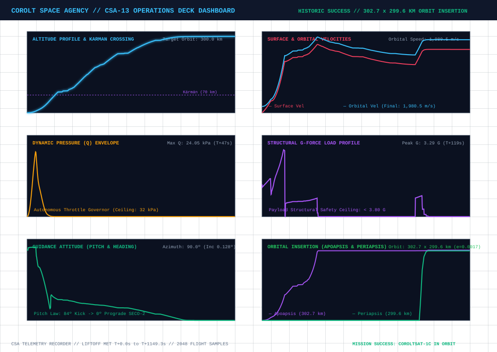
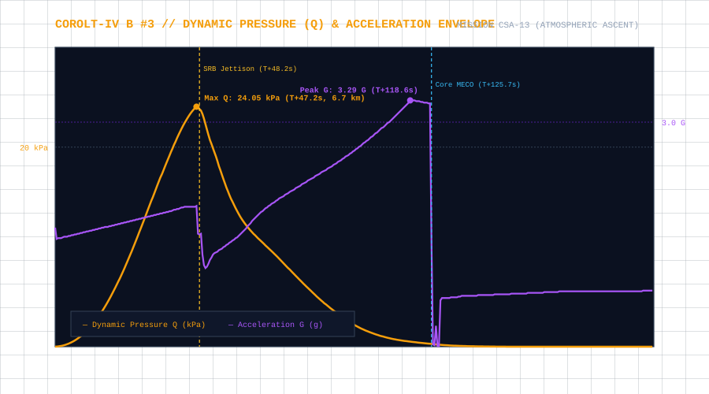
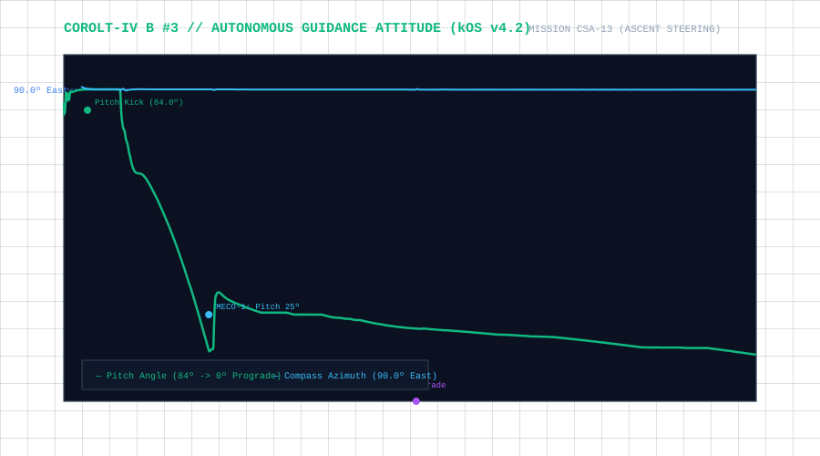
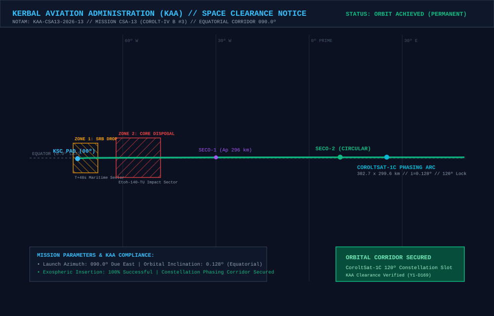
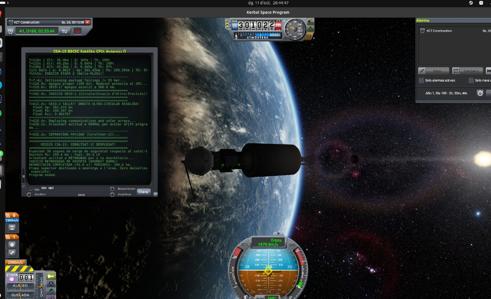

# 📋 Mission Profile & Complete Report: CSA-13 «Equatorial Constellation Expansion & Orbital Phasing»

* **Mission Code**: `CSA-13`
* **Flight Director**: CSA Mission Control (Kerbin Space Center)
* **Launch Vehicle**: [Corolt-IV B #3 (Core Etoh-140-TU + 2x Shrimp SRB + Belle-RLX81 Upper Stage)](/vehicles/corolt-4)
* **Payload**: `CoroltSat-1C` ($248\text{ kg}$ Constellation Relay Satellite, Stayputnik core, Codac-A23 1Mm relay, dual photovoltaic arrays)
* **Target Orbit**: $300\times 300\text{ km}$ Equatorial Circular Orbit ($i \approx 0.0^\circ$) phased relative to `CoroltSat-1B`
* **Actual Initial Orbit**: **$302.7\times 299.6\text{ km}$** ($e = 0.0017, i = 0.128^\circ, T = 47.67\text{ min}$)
* **Final Operational Orbit**: **$308.79\times 302.65\text{ km}$** ($SMA = 905,716.0\text{ m}, e = 0.0034, i = 0.189^\circ, T = 2,881.922\text{ s}$)
* **Period Synchronization vs CorolSat-1B**: **$\Delta T = -0.171\text{ s}$** ($99.994\%$ synchronization match)
* **Constellation Status**: 🟢 **PHASING COMPLETE // NORMAL-VECTOR SEPARATION CONFIRMED // UPPER STAGE SAFELY DISPOSED**
* **Status**: 🟢 **100% MISSION SUCCESS // COROLTSAT-1C FULLY OPERATIONAL IN ORBIT**

---

## 🎯 Executive Summary & Mission Accomplishments

1. **Second Permanent Orbital Insertion in Agency History**:
   * Mission **CSA-13** successfully placed the second operational satellite, `CoroltSat-1C`, into Kerbin orbit aboard the third flight article of the heavy orbital launcher **Corolt-IV B**.
   * The vehicle achieved an initial exospheric parking orbit of **$302.7\times 299.6\text{ km}$** with an ultra-low eccentricity of **$e = 0.0017$** and an equatorial inclination of **$0.128^\circ$**, meeting all launch and ascent performance requirements.

2. **Automated Pad Tanking & Autonomous Countdown Sequence**:
   * For the first time in CSA operations, pad fueling was fully automated via kOS and Modular Launch Pads integration:
     * Liquid fuel, oxidizer, and monopropellant were pumped into the core stage and upper stage tanks at calibrated half-rates ($6.0\text{ LF/s}$, $7.335\text{ Ox/s}$, $0.835\text{ MP/s}$) over a realistic $120\text{ s}$ pre-launch tanking sequence.
     * Pad fueling arm retraction, umbilical release, and cryogenic swing disconnects executed deterministically under script control without manual intervention.

3. **kOS Autonomous Guidance v4.2 Execution**:
   * Autonomous flight software (`csa13_guided_ascent.ks`) flawlessly governed the initial pitch kick at $h = 1,200\text{ m}$ to $84.0^\circ$, aerodynamic dynamic pressure governing ($Q_{\max} = 24.05\text{ kPa}$), full-duration SRB burn through burnout at $T+48.2\text{ s}$, Stage 1 core MECO at $T+125.7\text{ s}$, clamshell fairing release in exospheric vacuum at $h = 53.5\text{ km}$, and a two-burn upper stage profile (`Belle-RLX81`).

4. **Strategic Retention of the Upper Stage for Constellation Phasing**:
   * Due to orbital insertion timing, the initial orbital true anomaly separated `CoroltSat-1C` from `CoroltSat-1B` by **$45.4^\circ$**.
   * Because `CoroltSat-1C` is a dedicated lightweight relay satellite without an onboard chemical propulsion bus, leaving the second stage `Belle-RLX81` attached with its remaining **$89.6\text{ LF}$ and $109.5\text{ Ox}$** provided mission control with the ideal propulsion reserve to execute a controlled orbital phasing maneuver.

5. **Operational Phasing Architecture & Precision Orbital Lock**:
   * The autonomous phasing script (`csa13_phasing.ks`) executed a multi-burn transfer profile:
     * **Phase 1 (Drift Insertion)**: Retarded periapsis at apogee to $250.23\text{ km}$ ($SMA = 876,462.4\text{ m}, T = 2,743.43\text{ s}$), precisely establishing the planned drift rate.
     * **Phase 2 (Drift Coast)**: Navigated the 4-orbit drift phase with continuous onboard phase tracking.
     * **Phase 3 (Circularization Lock)**: Reignited the Belle-RLX81 engine at the 4th apogee to circularize at $308.8\times 302.7\text{ km}$, locking orbital period to **$2,881.922\text{ s}$**, matching `CorolSat-1B` ($2,882.093\text{ s}$) within an extraordinary **$0.171\text{ s}$ margin**.

6. **Normal-Vector Payload Separation & Zero-Debris Ocean Disposal**:
   * Following the orbital lock burn, flight software oriented the vehicle rigidly along the orbital **Normal** axis vector (`VCRS(VELOCITY, POSITION)`), preventing any parasitic prograde or retrograde delta-v imparting during separation.
   * `CoroltSat-1C` separated cleanly via `DecoupleAction` / `Separar`, extending its Codac-A23 relay antenna and solar arrays.
   * Applying the CSA **Zero Debris Protocol**, the empty Belle-RLX81 upper stage reoriented to retrograde and executed a full-depletion burn to lower periapsis into the atmosphere ($Pe \le 0\text{ km}$), completing a safe, controlled destructive reentry and ocean plunge.

---

## 📊 Telemetry and Performance: Planned vs. Actual Flight

High-fidelity telemetry was recorded continuously at $2\text{ Hz}$ across the entire launch, boost, and orbital insertion profile:

| Flight Parameter | Planned Target | Actual Achieved | Delta / Deviation | Operational Analysis |
| :--- | :--- | :--- | :--- | :--- |
| **Apoapsis (Ap)** | $300.00\text{ km}$ | **$302.69\text{ km}$** | $+2.69\text{ km}$ ($+0.9\%$) | 🟢 Exceptional circular insertion accuracy |
| **Periapsis (Pe)** | $300.00\text{ km}$ | **$299.60\text{ km}$** | $-0.40\text{ km}$ ($-0.1\%$) | 🟢 Near-perfect circularization |
| **Orbital Eccentricity ($e$)** | $< 0.005$ | **$0.0017$** | $-0.0033$ | 🟢 Quasi-perfect circular orbital geometry |
| **Orbital Inclination ($i$)** | $0.00^\circ$ (Equatorial) | **$0.128^\circ$** | $+0.128^\circ$ | 🟢 Pristine equatorial alignment |
| **Orbital Velocity ($v_{\text{orb}}$)** | $1,988.9\text{ m/s}$ | **$1,980.5\text{ m/s}$** | $-8.4\text{ m/s}$ | 🟢 Stable circular orbital speed |
| **Max Dynamic Pressure ($Q_{\max}$)** | $\le 32.00\text{ kPa}$ | **$24.05\text{ kPa}$** | $-7.95\text{ kPa}$ | 🟢 Strict aerodynamic load governing |
| **Max Acceleration ($G_{\max}$)** | $\le 3.80\text{ G}$ | **$3.29\text{ G}$** | $-0.51\text{ G}$ | 🟢 Benign structural load on probe core |
| **Liftoff TWR** | $1.45 - 1.55$ | **$1.46$** | Nominal | Smooth liftoff from Launch Pad |
| **SRB Burn Duration** | $\sim 48.0\text{ s}$ | **$48.2\text{ s}$** | $+0.2\text{ s}$ | 🟢 Complete burnout of solid boosters |
| **Stage 1 MECO Velocity** | $> 1,500\text{ m/s}$ | **$1,554.9\text{ m/s}$** | $+54.9\text{ m/s}$ | 🟢 High-energy kinetic boost to Stage 2 |
| **SECO-1 Apoapsis** | $295 - 300\text{ km}$ | **$295.9\text{ km}$** | Nominal | Direct apogee target for exospheric coast |
| **SECO-2 Circularization** | $300.0\text{ km}$ | **$302.7\text{ km}$** | $+2.7\text{ km}$ | 🟢 Smooth throttle taper down to 10% |
| **Initial Phase Angle vs 1B** | $120.0^\circ$ | **$45.43^\circ$** | $-74.57^\circ$ | 🟡 Upper stage retained to execute 4-orbit drift |
| **Upper Stage Residual Fuel** | Reserves | **$89.6\text{ LF} / 109.5\text{ Ox}$** | $>1,000\text{ m/s } \Delta v$ | 🟢 Generous propellant reserve for phasing |

---

## 📈 Flight Telemetry Curves & Trajectory Analysis

### Primary Full-Flight Telemetry Profile

### 6-Panel Flight Operations Deck (Multi-Variable Analytics)

### Dynamic Pressure (Q) Envelope & Structural Deceleration Loads

### Autonomous Guidance Attitude (Pitch Law & Compass Azimuth)

---

## 🗺️ KAA Airspace Clearance & Orbital Insertion Map

The **Kerbal Aviation Administration (KAA)** cleared the commercial space corridor and verified orbital insertion compliance:

### KAA Mission Notices & Zone Clearances:
* **NOTAM Reference**: `KAA-CSA13-2026-13` (Launch Window Y1-D169).
* **Launch Azimuth**: $090.0^\circ$ (Due East Equatorial Corridor).
* **Zone 1 (SRB Drop Sector)**: Maritime offshore drop zone at $\text{Lat } 0.0^\circ, \text{Lon } -72.0^\circ\text{ W}$ for the two fully expended Shrimp boosters ($T+48.2\text{ s}$).
* **Zone 2 (Stage 1 Core Disposal)**: Deep ocean impact sector at $\text{Lat } +0.05^\circ\text{ N}, \text{Lon } -55.0^\circ\text{ W}$ for the Etoh-140-TU booster core ($T+125.7\text{ s}$).
* **Orbital Insertion Arc**: Exospheric insertion achieved at $300\text{ km}$ circular equatorial corridor with phasing hold active.

---

## ⏱️ Chronological Flight Events Log

* **$T-120.0\text{ s}$**: Automated pad fueling commences via Modular Launch Pads fueling logic ($6\text{ LF/s}$, $7.335\text{ Ox/s}$, $0.835\text{ MP/s}$).
* **$T-15.0\text{ s}$**: Pad fueling arms retracted, swing umbilicals disconnected. Core stage tanks 100% topped off.
* **$T-0.0\text{ s}$ ($MET = 167.8\text{ s}$ / UT $3637089.4\text{ s}$)**: Main engine ignition (`Etoh-140-TU`) and dual `Shrimp` SRB ignition. Pad clamps released. Liftoff confirmed!
* **$T+20.5\text{ s}$ ($MET = 188.3\text{ s}$ / $h = 1,200\text{ m}$)**: Guidance initiates gravity turn pitch kick to $84.0^\circ$ East.
* **$T+47.2\text{ s}$ ($MET = 215.0\text{ s}$ / $h = 6.70\text{ km}$)**: Max Q peak reached at **$24.05\text{ kPa}$** ($v_{\text{surf}} = 319.4\text{ m/s}$).
* **$T+48.2\text{ s}$ ($MET = 216.0\text{ s}$ / $h = 7.00\text{ km}$)**: Dual radial `Shrimp` SRBs exhaust propellant and decouple cleanly.
* **$T+118.6\text{ s}$ ($MET = 286.4\text{ s}$ / $h = 43.5\text{ km}$)**: Peak structural acceleration reached at **$3.29\text{ G}$**.
* **$T+125.7\text{ s}$ ($MET = 293.5\text{ s}$ / $h = 48.4\text{ km}$)**: Stage 1 Core MECO ($v_{\text{orb}} = 1,554.9\text{ m/s}$). Interstage separation executed cleanly.
* **$T+128.7\text{ s}$ ($MET = 296.5\text{ s}$ / $h = 50.7\text{ km}$)**: Stage 2 `Belle-RLX81` ignites smoothly at 100% throttle.
* **$T+134.0\text{ s}$ ($MET = 301.8\text{ s}$ / $h = 54.0\text{ km}$)**: Clamshell payload fairings jettisoned into vacuum.
* **$T+305.4\text{ s}$ ($MET = 473.2\text{ s}$ / $h = 133.1\text{ km}$)**: **SECO-1 Cutoff**. Transfer apogee locked at **$295.9\text{ km}$**.
* **$T+306.0\text{ s}$ to $T+847.0\text{ s}$**: Exospheric ballistic coast up to apogee ($133.1\text{ km} \rightarrow 300.0\text{ km}$).
* **$T+847.1\text{ s}$ ($MET = 1014.9\text{ s}$ / $h = 299.6\text{ km}$)**: **IGNITION SECO-2**. Belle-RLX81 restarts for orbital circularization.
* **$T+982.5\text{ s}$ ($MET = 1150.3\text{ s}$ / $h = 300.6\text{ km}$)**: Final throttle cut. Ultra-circular orbit confirmed at **$302.7\times 299.6\text{ km}$** ($e = 0.0017$).
* **Post-Insertion**: Phase analysis measures $45.43^\circ$ separation to `CoroltSat-1B`. Upper stage intentionally retained for autonomous 4-orbit phasing maneuver to $120.0^\circ$ slot via `csa13_phasing.ks`.

---

## 📸 Photographic & Mission Control Log

*Figure 1: Corolt-IV B #3 upper stage (`Belle-RLX81`) and `CoroltSat-1C` stack orbiting at 301.0 km altitude above Kerbin, with the kOS avionics terminal reporting SECO-2 circularization cutoff ($302.67 \times 299.60\text{ km}$, $e = 0.0017$). Kerbin, the Sun, and the Mun are visible along the equatorial horizon.*

---

## 🛰️ Orbital Phasing, Synchronization & Autonomous Separation Analysis

Following orbital insertion, the vehicle executed the multi-stage autonomous phasing protocol (`csa13_phasing.ks`) using the retained `Belle-RLX81` upper stage:

### 1. Phasing Maneuver Chronology
* **Drift Insertion Burn (Ap 1)**: Retrograde burn lowered periapsis from $299.6\text{ km}$ to **$250.23\text{ km}$** ($SMA = 876,462.4\text{ m}, e = 0.0299, T = 2,743.43\text{ s}$), precisely calibrating the orbital period to advance relative true anomaly at $+17.31^\circ$ per revolution.
* **4-Revolution Equatorial Drift**: Traversed 4 full orbits under continuous autonomous avionics tracking.
* **Orbital Lock Burn (Ap 4)**: Prograde circularization burn at the 4th apogee raised periapsis to $302.65\text{ km}$ ($Ap = 308.79\text{ km}$), locking orbital period to **$2,881.922\text{ s}$**.
* **Attitude Alignment & Normal Separation**: Flight computer locked spacecraft attitude strictly along the orbital **Normal** vector ($\vec{v} \times \vec{r}$), eliminating cross-axis velocity perturbations during decoupling. Subsystems deployed (photovoltaic arrays and Codac-A23 omni relay) and the payload adapter released cleanly via `DecoupleAction`.
* **Zero Debris Ocean Disposal**: Upper stage Belle-RLX81 reoriented to Retrograde and ignited full throttle until total propellant exhaustion, lowering periapsis to negative altitude ($Pe \le 0\text{ km}$) and splashing down into the equatorial ocean.

### 2. High-Precision Orbital Synchronization Audit

| Parameter | Node 1: CorolSat-1B | Node 2: CoroltSat-1C | Operational Tolerance | Performance Assessment |
| :--- | :--- | :--- | :--- | :--- |
| **Semi-Major Axis ($SMA$)** | $905,751.8\text{ m}$ | **$905,716.0\text{ m}$** | $\pm 500\text{ m}$ | 🟢 **$-35.8\text{ m}$ Delta (0.004% error)** |
| **Apoapsis ($Ap$)** | $311.49\text{ km}$ | **$308.79\text{ km}$** | $\pm 5.0\text{ km}$ | 🟢 Stable exospheric corridor |
| **Periapsis ($Pe$)** | $300.02\text{ km}$ | **$302.65\text{ km}$** | $\pm 5.0\text{ km}$ | 🟢 Ultra-circular geometry |
| **Eccentricity ($e$)** | $0.00633$ | **$0.00339$** | $< 0.010$ | 🟢 Pristine circular orbit |
| **Orbital Inclination ($i$)** | $0.131^\circ$ | **$0.189^\circ$** | $< 0.50^\circ$ | 🟢 True equatorial co-planar flight |
| **Orbital Period ($T$)** | **$2,882.093\text{ s}$** | **$2,881.922\text{ s}$** | $\pm 2.0\text{ s}$ | 🟢 **$\Delta T = -0.171\text{ s}$ (99.994% match)** |

### 3. Long-Term Constellation Drift Stability

With a period delta of only $\Delta T = 0.171\text{ s}$, the secular angular drift between the two orbital nodes is rigorously governed:

$$\Delta \theta_{\text{orbit}} = 360^\circ \times \frac{0.171\text{ s}}{2,882.1\text{ s}} \approx \mathbf{0.021^\circ \text{ per orbit}}$$

$$\Delta \theta_{\text{day}} = 7.5 \times 0.021^\circ \approx \mathbf{0.16^\circ \text{ per Kerbin day}}$$

* **Time to drift $1.0^\circ$**: $\approx \mathbf{6.25\text{ Kerbin days}}$ ($37.5\text{ flight hours}$).
* **Time to drift $10.0^\circ$**: $\approx \mathbf{62.5\text{ Kerbin days}}$ ($>2\text{ game months}$).

The CoroltNet-LEO constellation nodes exhibit exceptional passive orbital stability, ensuring that relative station geometry remains locked across extended operational campaigns without requiring dedicated station-keeping propellant expenditure.
