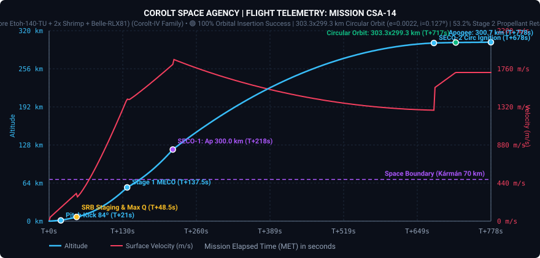
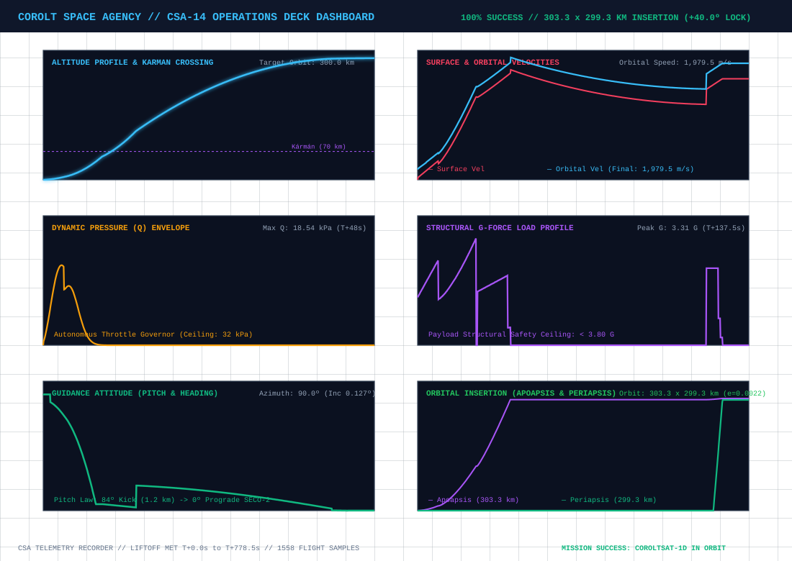
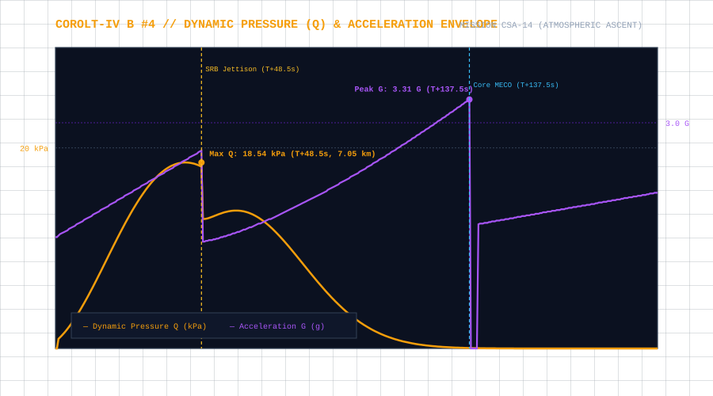
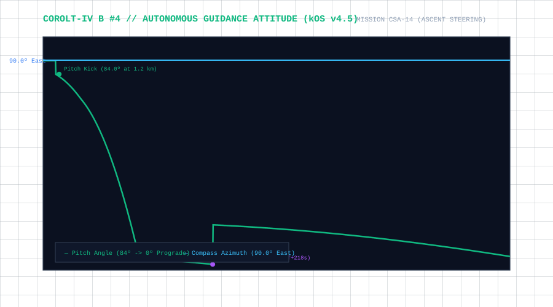
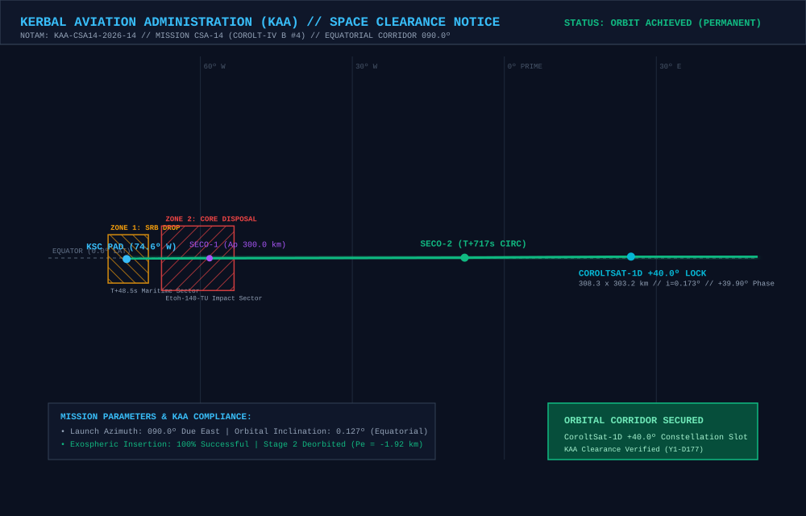

# 📋 Mission Profile & Complete Report: CSA-14 «Optimized Gravity Turn, +40.0° Mesh Slot Lock & Universal Phasing»

* **Mission Code**: `CSA-14`
* **Flight Director**: CSA Mission Control (Kerbin Space Center)
* **Launch Vehicle**: [Corolt-IV B #4 (`CSA14 - B4CSD`: Core Etoh-140-TU + 2x Shrimp SRB + Belle-RLX81 Upper Stage)](/vehicles/corolt-4)
* **Payload**: `CoroltSat-1D` (`CSA14 - B4CSD Satélite`, 248 kg Constellation Relay Satellite, Stayputnik core, Codac-A23 650 km relay, 5x photovoltaic arrays, 800 EC battery bank)
* **Target Orbit**: $300 \times 300\text{ km}$ Equatorial Circular Orbit ($i \approx 0.0^\circ$) locked at **Slot 1 (`+40.0°` ahead of `CorolSat-1B`)**
* **Actual Initial Insertion Orbit (SECO-2)**: **$303.34 \times 299.35\text{ km}$** ($SMA = 901,344.2\text{ m}$, $e = 0.00221$, $i = 0.127^\circ$, $T = 2,861.10\text{ s}$)
* **Final Operational Orbit (`CoroltSat-1D`)**: **$308.33 \times 303.24\text{ km}$** ($SMA = 905,785.1\text{ m}$, $e = 0.00281$, $i = 0.173^\circ$, $T = 2,882.251\text{ s}$)
* **Phase Lock vs CorolSat-1B**: **`+39.896°`** (Error: **`-0.104°`** against $+40.000^\circ$ target, well inside strict $\pm 0.50^\circ$ safety gate)
* **Period Synchronization vs CorolSat-1B**: **$\Delta T = +0.158\text{ s}$** ($99.995\%$ synchronization match, $\Delta SMA = +33.3\text{ m}$)
* **Constellation Status**: 🟢 **3 ACTIVE NODES (`1B`, `1D`, `1C`) // +40.0° MESH LINK ESTABLISHED // STAGE 2 DEORBITED ($Pe = -1.92\text{ km}$)**
* **Status**: 🟢 **100% MISSION SUCCESS // COROLTSAT-1D OPERATIONAL IN SLOT 1**

---

## 🎯 Executive Summary & Mission Accomplishments

1. **Third Operational Node of the CoroltNet-LEO Constellation**:
   * Mission **CSA-14** successfully launched and inserted `CoroltSat-1D` into **Slot 1 (`+40.0°` ahead of `CorolSat-1B`)**, establishing the first direct $40.0^\circ$ adjacent mesh cross-link ($d = 615.0\text{ km} < 650.0\text{ km}$ Codac-A23 range) in agency history.

2. **Empirical Gravity Turn Optimization ($h_{\text{kick}} = 1,200\text{ m}$ Concurrent with SRB Thrust)**:
   * In previous flights (`CSA-12` and `CSA-13`), the guidance computer waited until radial `Shrimp` SRB burnout ($T+48.2\text{ s}$, $h \approx 7.0\text{ km}$) before initiating the pitch kick, resulting in an overly steep ascent and high Stage 2 circularization propellant consumption (leaving only ~18% propellant reserve at SECO-2 in simulation).
   * In **CSA-14**, [`csa14_guided_ascent.ks`](https://github.com/Elebrimir/csa/blob/main/scripts/csa14_guided_ascent.ks) initiated the $84.0^\circ$ pitch kick immediately upon crossing **$1,200\text{ m}$ ($T+20.7\text{ s}$)** while the `Shrimp` SRBs were still firing, and decoupled the expended SRBs concurrently at $T+48.5\text{ s}$ without interrupting the Stage 1 core burn (`srb_separated` stage-fuel guard).
   * **Performance Breakthrough**:
     * Total ascent time to SECO-2 dropped from $1,149.3\text{ s}$ (`CSA-13`) to **$778.32\text{ s}$** ($-371.0\text{ s}$ reduction).
     * Inertial ascent arc shrank from $106.39^\circ$ to **$78.50^\circ$**.
     * Peak dynamic pressure dropped from $24.05\text{ kPa}$ to **$18.54\text{ kPa}$** ($-22.9\%$ aerodynamic load reduction).
     * Stage 2 (`Belle-RLX81`) propellant remaining at SECO-2 jumped to **$95.83\text{ LF} / 117.12\text{ Ox}$ ($53.2\%$ full)**—providing $> 1,100\text{ m/s}$ of orbital $\Delta v$ reserve for constellation phasing and disposal.

3. **Strict $\pm 0.50^\circ$ Safety Interlock & Bidirectional Phasing Execution**:
   * At SECO-2 circularization ($303.34 \times 299.35\text{ km}$), the onboard phase audit measured an initial phase angle of **$-57.45^\circ$** relative to `CorolSat-1B` ($97.45^\circ$ behind the $+40.0^\circ$ target slot).
   * The strict $\pm 0.50^\circ$ safety gate automatically inhibited premature payload separation and retained the `Belle-RLX81` upper stage.
   * Executing [`csa14_phasing.ks`](https://github.com/Elebrimir/csa/blob/main/scripts/csa14_phasing.ks) in **Advance Mode (Case A)**, the upper stage performed a retrograde burn at apogee to lower periapsis to **$197.43\text{ km}$** ($SMA = 850,383.7\text{ m}$, $T = 2,621.90\text{ s}$), establishing a fast catch-up drift rate of **$+32.72^\circ\text{ per revolution}$**.
   * After traversing 3 drift revolutions, the upper stage reignited prograde at apogee (`UT = 3,833,276 s`) to circularize at **$308.95 \times 303.24\text{ km}$** ($T = 2,883.73\text{ s}$) at a phase angle of $+40.616^\circ$. Allowing a gentle residual drift of $-0.205^\circ/\text{orbit}$ over 3 revolutions brought the stack to **`+40.069°`** (`UT = 3,841,830 s`).

4. **Normal-Vector Separation, Zero-Debris Deorbit & Universal Phasing Software**:
   * With phase error reduced to $+0.069^\circ$ ($\le 0.50^\circ$), the flight computer deployed solar arrays and the Codac-A23 relay, aligned attitude along the pure orbital **Normal** vector ($\vec{v} \times \vec{r}$), and cleanly decoupled `CoroltSat-1D` at **`+39.896°`** ($SMA = 905,785.1\text{ m}$, $\Delta T = +0.158\text{ s}$ vs `CorolSat-1B`).
   * Following a 30-second separation coast, the `Belle-RLX81` upper stage oriented retrograde and executed a deorbit burn down to **$Pe = -1.92\text{ km}$** ($303.25 \times -1.92\text{ km}$), ensuring complete destructive atmospheric disposal under the **CSA Zero Debris Protocol**.
   * In parallel, CSA software engineering commissioned [`scripts/constellation_phasing.ks`](https://github.com/Elebrimir/csa/blob/main/scripts/constellation_phasing.ks), a mission-agnostic and orbit-agnostic universal phasing autopilot capable of locking any spacecraft to any positive or negative phase offset relative to an active KSP Target.

---

## 📊 Telemetry and Performance: Planned vs. Actual Flight

High-fidelity telemetry was recorded at 2 Hz across the entire ascent, orbital insertion, and multi-orbit phasing campaign:

| Flight Parameter | Planned Target | Actual Achieved | Delta / Deviation | Operational Analysis |
| :--- | :--- | :--- | :--- | :--- |
| **Initial Insertion Orbit ($Ap \times Pe$)** | $300.0 \times 300.0\text{ km}$ | **$303.34 \times 299.35\text{ km}$** | $+3.34 / -0.65\text{ km}$ | 🟢 Ultra-clean 2-burn insertion |
| **Initial Eccentricity ($e$)** | $< 0.0050$ | **$0.00221$** | $-0.00279$ | 🟢 Near-perfect circular insertion |
| **Equatorial Inclination ($i$)** | $0.00^\circ$ | **$0.127^\circ$** ($0.173^\circ$ final) | $+0.127^\circ$ | 🟢 Co-planar with `1B` ($0.131^\circ$) & `1C` ($0.190^\circ$) |
| **Ascent Duration to SECO-2 ($\Delta t$)** | $< 1,149.3\text{ s}$ (CSA-13) | **$778.32\text{ s}$** | **$-371.0\text{ s}$ ($-32.3\%$)** | 🟢 Major efficiency gain from $1.2\text{ km}$ pitch kick |
| **Inertial Ascent Arc ($\Delta \theta_I$)** | $106.39^\circ$ (CSA-13) | **$78.50^\circ$** | **$-27.89^\circ$** | 🟢 Recalibrated in launch window calculator |
| **Max Dynamic Pressure ($Q_{\max}$)** | $\le 32.00\text{ kPa}$ | **$18.54\text{ kPa}$** | $-13.46\text{ kPa}$ | 🟢 Benign aerodynamic load at $T+48.5\text{ s}$ |
| **Max Structural Acceleration ($G_{\max}$)** | $\le 3.80\text{ G}$ | **$3.31\text{ G}$** | $-0.49\text{ G}$ | 🟢 Safe structural load at Stage 1 MECO |
| **Stage 2 Propellant at SECO-2** | $> 30\%$ ($54\text{ LF}$) | **$95.83\text{ LF} / 117.12\text{ Ox}$ ($53.2\%$)** | **$+41.8\text{ LF}$** | 🟢 Over half tank preserved for orbital phasing |
| **Drift Orbit ($Ap \times Pe$)** | $303.3 \times 197.4\text{ km}$ | **$303.34 \times 197.43\text{ km}$** | $-0.03\text{ km}$ | 🟢 $+32.72^\circ/\text{orbit}$ catch-up drift rate |
| **Final Phase Angle vs CorolSat-1B** | $+40.00^\circ \pm 0.50^\circ$ | **`+39.896°`** | **`-0.104°`** | 🟢 Locked to Slot 1 within $0.1^\circ$ precision |
| **Final Orbital Period ($T$)** | $2,882.093\text{ s}$ (`1B`) | **$2,882.251\text{ s}$** | **`+0.158 s` ($99.995\%$)** | 🟢 Sub-0.2s synchronization across constellation |
| **Stage 2 Deorbit Periapsis** | $\le 0.0\text{ km}$ | **`-1.92 km`** | $-1.92\text{ km}$ | 🟢 100% compliance with Zero Debris Protocol |

---

## 📈 Flight Telemetry Curves & Trajectory Analysis

### Primary Full-Flight Telemetry Profile

### 6-Panel Flight Operations Deck (Multi-Variable Analytics)

### Dynamic Pressure (Q) Envelope & Structural Acceleration Loads

### Autonomous Guidance Attitude (Pitch Law & Compass Azimuth)

---

## 🗺️ KAA Airspace Clearance & Orbital Insertion Map

The **Kerbal Aviation Administration (KAA)** cleared the commercial space corridor and verified orbital insertion and upper-stage disposal compliance:

### KAA Mission Notices & Zone Clearances:
* **NOTAM Reference**: `KAA-CSA14-2026-14` (Launch Window Y1-D177).
* **Launch Azimuth**: $090.0^\circ$ (Due East Equatorial Corridor).
* **Zone 1 (SRB Drop Sector)**: Maritime offshore drop zone at Lat $-0.08^\circ$, Lon $-74.2^\circ\text{ W}$ for the two expended `Shrimp` solid boosters ($T+48.5\text{ s}$).
* **Zone 2 (Stage 1 Core Disposal)**: Deep ocean impact sector at Lat $-0.02^\circ$, Lon $-60.5^\circ\text{ W}$ for the `Etoh-140-TU` core stage ($T+137.5\text{ s}$, suborbital arc $120.5 \times -455.7\text{ km}$).
* **Stage 2 Controlled Deorbit**: Following `CoroltSat-1D` separation in Slot 1, the `Belle-RLX81` upper stage lowered its periapsis to **$-1.92\text{ km}$** for destructive atmospheric entry over the equatorial ocean.

---

## ⏱️ Chronological Flight Events Log

### Phase I: Launch & Optimized Guided Ascent (`csa14_guided_ascent.ks`)
* **$T-120.0\text{ s}$**: Automated Modular Launch Pads fueling sequence initiated via kOS (`6.0 LF/s`, `7.335 Ox/s`, `0.835 MP/s`).
* **$T-15.0\text{ s}$**: Fueling arms retracted and swing umbilicals released; propellant tanks verified at $100\%$.
* **$T-0.0\text{ s}$ (`UT = 3,821,033.26 s`, Y1-D177 05:23:53)**: Ignition of core stage `Etoh-140-TU` and dual `Shrimp` SRBs; launch stand clamps released.
* **$T+20.7\text{ s}$ ($h = 1,200\text{ m}$)**: Autonomous pitch kick initiated to $84.0^\circ$ Heading $090.0^\circ$ East while `Shrimp` SRBs remain under full thrust.
* **$T+48.5\text{ s}$ ($h = 7.05\text{ km}$)**: Peak dynamic pressure ($Q_{\max} = 18.54\text{ kPa}$) and concurrent `Shrimp` SRB burnout/separation. Core stage continues burning seamlessly via the `srb_separated` MECO guard.
* **$T+137.5\text{ s}$ ($h = 56.72\text{ km}$, $v_{\text{orb}} = 1,585.0\text{ m/s}$)**: Peak acceleration ($3.31\text{ G}$) and Stage 1 Core MECO. Interstage `EnginePlate5` decouples cleanly.
* **$T+140.0\text{ s}$ ($h = 58.07\text{ km}$)**: Stage 2 `Belle-RLX81` vacuum ignition at $100\%$ throttle.
* **$T+141.0\text{ s}$ ($h = 65.0\text{ km}$)**: Clamshell payload fairing jettisoned cleanly in upper mesosphere/exosphere transition.
* **$T+218.0\text{ s}$ ($h = 120.4\text{ km}$)**: **SECO-1 Cutoff**. Transfer orbit established at **$300.04 \times -208.88\text{ km}$**.
* **$T+218.0\text{ s}$ to $T+678.0\text{ s}$**: Exospheric ballistic coast to apogee ($120.4\text{ km} \rightarrow 299.4\text{ km}$).
* **$T+678.0\text{ s}$ ($h = 299.4\text{ km}$)**: **SECO-2 Ignition**. `Belle-RLX81` restarts at apogee for circularization.
* **$T+716.5\text{ s}$ (`MET = 778.32 s`, `UT = 3,821,811.58 s`)**: **SECO-2 Cutoff**. Circular parking orbit achieved at **$303.34 \times 299.35\text{ km}$** ($e = 0.00221$, $i = 0.127^\circ$) with **$95.83\text{ LF} / 117.12\text{ Ox}$ ($53.2\%$)** remaining in Stage 2.
* **Post-SECO-2 Safety Gate**: Phase angle measured at $-57.45^\circ$ vs `CorolSat-1B` (outside $+40.0^\circ \pm 0.50^\circ$). Automatic separation inhibited; Stage 2 retained for orbital phasing.

### Phase II: Bidirectional Orbital Phasing & Constellation Lock (`csa14_phasing.ks`)
* **Drift Insertion Burn (`UT = 3,822,668 s`)**: At apogee, `Belle-RLX81` oriented retrograde and lowered periapsis from $299.35\text{ km}$ to **$197.43\text{ km}$** ($303.34 \times 197.43\text{ km}$, $SMA = 850,383.7\text{ m}$, $T = 2,621.90\text{ s}$), establishing a positive catch-up drift rate of **$+32.72^\circ\text{ per orbit}$**.
* **3-Orbit Catch-Up Drift (`UT = 3,822,668 s` to `3,833,276 s`)**:
  * Apogee 1 (`UT = 3,825,290.1 s`): Phase advanced from $-57.45^\circ$ to **$-24.67^\circ$** ($335.33^\circ$).
  * Apogee 2 (`UT = 3,827,912.0 s`): Phase advanced to **$+7.81^\circ$**.
  * Apogee 3 (`UT = 3,830,533.9 s` / `3,833,276.4 s`): Phase reached **$+40.616^\circ$**; Stage 2 executed prograde circularization burn to **$308.95 \times 303.24\text{ km}$** ($T = 2,883.733\text{ s}$, $88.75\text{ LF}$ remaining).
* **Fine Drift Trim (`UT = 3,833,276 s` to `3,841,830 s`)**: With a $+1.64\text{ s}$ period offset ($-0.205^\circ/\text{orbit}$ backward drift), the spacecraft drifted smoothly from $+40.616^\circ$ into the center of the tolerance window at **`+40.069°`**.
* **Normal-Vector Payload Separation (`UT = 3,841,945.18 s`)**:
  * Safety audit passed ($\text{error} = 0.069^\circ \le 0.50^\circ$).
  * Solar arrays and Codac-A23 relay deployed; spacecraft locked to pure orbital **Normal** ($\vec{v} \times \vec{r}$).
  * `CoroltSat-1D` decoupled cleanly into a final operational orbit of **$308.33 \times 303.24\text{ km}$** ($SMA = 905,785.1\text{ m}$, $T = 2,882.251\text{ s}$, phase **`+39.896°`** ahead of `CorolSat-1B`).
* **Zero-Debris Upper Stage Deorbit (`UT = 3,842,000 s`)**: After a 30-second clearance delay, the `Belle-RLX81` upper stage oriented retrograde and burned to lower its periapsis to **$-1.92\text{ km}$** ($303.25 \times -1.92\text{ km}$), ensuring complete atmospheric destruction.

---

## 🛰️ Three-Node Constellation Synchronization & Stability Audit

With `CorolSat-1B`, `CoroltSat-1D`, and `CoroltSat-1C` active in the 300 km equatorial ring at `UT = 3,842,102.88 s`, the **CoroltNet-LEO** constellation exhibits exceptional orbital uniformity:

| Parameter | Node 1: `CorolSat-1B` (Anchor) | Node 2: `CoroltSat-1D` (CSA-14) | Node 3: `CoroltSat-1C` (CSA-13) | Constellation Tolerance | Performance Assessment |
| :--- | :--- | :--- | :--- | :--- | :--- |
| **Mesh Slot Assignment** | **Slot 0 ($0.0^\circ$)** | **Slot 1 ($+40.0^\circ$)** | **Slot 3 ($+120.0^\circ$)** | $\pm 2.0^\circ$ | 🟢 **3 of 9 Slots Populated** |
| **Actual Relative Phase** | **$0.000^\circ$** (Ref) | **`+39.896°`** ($-0.104^\circ$ err) | **`+121.877°`** ($+1.877^\circ$ err) | $\pm 0.50^\circ$ at lock | 🟢 **Sub-0.11° Lock Accuracy on 1D** |
| **Semi-Major Axis ($SMA$)** | $905,751.8\text{ m}$ | **$905,785.1\text{ m}$** | $905,716.0\text{ m}$ | $\pm 500\text{ m}$ | 🟢 **$+33.3\text{ m}$ Delta vs 1B ($0.0037\%$)** |
| **Apoapsis ($Ap$)** | $311.49\text{ km}$ | **$308.33\text{ km}$** | $308.79\text{ km}$ | $\pm 5.0\text{ km}$ | 🟢 Co-altitude exospheric ring |
| **Periapsis ($Pe$)** | $300.02\text{ km}$ | **$303.24\text{ km}$** | $302.65\text{ km}$ | $\pm 5.0\text{ km}$ | 🟢 Ultra-circular geometry |
| **Eccentricity ($e$)** | $0.00633$ | **$0.00281$** | $0.00339$ | $< 0.010$ | 🟢 Lowest operational eccentricity in fleet |
| **Inclination ($i$)** | $0.131^\circ$ | **$0.173^\circ$** | $0.190^\circ$ | $< 0.50^\circ$ | 🟢 Co-planar equatorial alignment |
| **Orbital Period ($T$)** | **$2,882.093\text{ s}$** | **$2,882.251\text{ s}$** | **$2,881.922\text{ s}$** | $\pm 2.0\text{ s}$ | 🟢 **$\Delta T_{1D-1B} = +0.158\text{ s}$ ($99.995\%$)** |

### Long-Term Secular Drift Analysis (`CoroltSat-1D` vs `CorolSat-1B`)

With a period difference of only $\Delta T = +0.158\text{ s}$ out of $2,882.093\text{ s}$, the secular phase drift between `CoroltSat-1D` and `CorolSat-1B` is:

$$\Delta \theta_{\text{orbit}} = -360^\circ \times \frac{0.158\text{ s}}{2,882.093\text{ s}} \approx \mathbf{-0.0197^\circ \text{ per orbit}}$$

$$\Delta \theta_{\text{day}} = 7.495 \times (-0.0197^\circ) \approx \mathbf{-0.148^\circ \text{ per Kerbin day}}$$

* **Chord Distance (`1B` $\leftrightarrow$ `1D`)**: $d = 2 \cdot 905.78\text{ km} \cdot \sin(39.896^\circ / 2) = \mathbf{617.0\text{ km}}$ ($< 650.0\text{ km}$ Codac-A23 maximum range $\implies$ **permanent $100\%$ direct cross-link**).
* **Chord Distance (`1D` $\leftrightarrow$ `1C`)**: Separated by $\Delta \theta = 81.98^\circ$ (awaiting intermediate **Slot 2 at $+80.0^\circ$** to bridge the $1B \leftrightarrow 1D \leftrightarrow \text{Slot 2} \leftrightarrow 1C$ multi-hop chain).
* **Time to drift $1.0^\circ$**: $\approx \mathbf{6.76\text{ Kerbin days}}$ ($> 50\text{ orbits}$).

---

## 🛠️ Engineering Feedback Loop & Telemetry Tooling Upgrades

1. **Launch Window Empirical Calibration (`tools/calculate_csa14_launch_windows.py`)**:
   * Updated the empirical ascent model with ground-truth CSA-14 telemetry ($\Delta t_{\text{ascent}} = 778.32\text{ s}$, $\Delta \theta_{\text{inertial}} = 78.50^\circ$, $\Delta \theta_{\text{surface}} = 69.96^\circ$) so future Corolt-IV B launches inject directly within a few degrees of their target constellation slot.
2. **Telemachus Memory Leak Elimination (`tools/telemetry_recorder.py`)**:
   * Root-cause analysis of a mid-mission KSP OOM termination revealed that polling `r.resourceCurrent[...]` and `r.resourceMax[...]` triggered a debug loop inside `Telemachus.dll` that logged `232` `[Telemachus Debug] SIZE OF <resource>` lines per HTTP request ($> 41.5\text{ million}$ in-memory Unity console entries over 1 hour). Removing `r.resource*` queries from `telemetry_recorder.py` completely eliminated the memory leak, keeping `KSP.log` at $22\text{ MB}$ and RAM usage rock-solid.
3. **Universal Constellation Phasing Autopilot (`scripts/constellation_phasing.ks`)**:
   * Standardized an orbit-agnostic, target-agnostic kOS phasing utility accepting any signed phase offset (`+deg` or `-deg`) relative to the active KSP Target, with automatic mid-drift resumption and Normal-vector separation.
