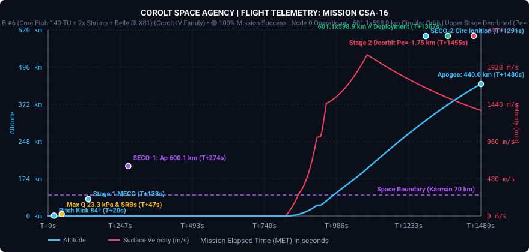
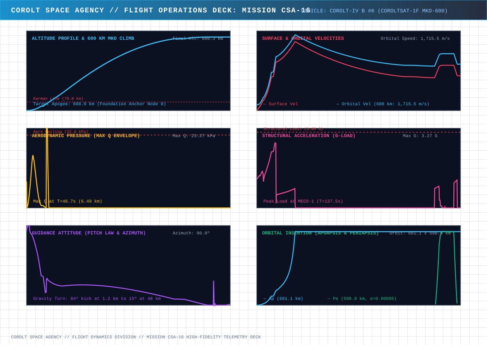
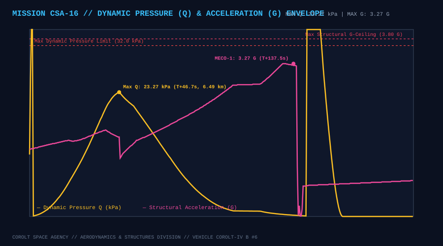
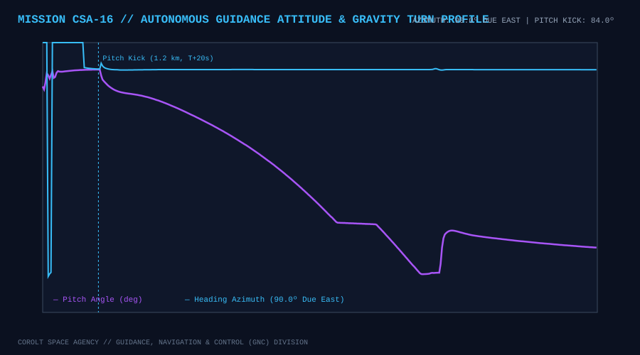
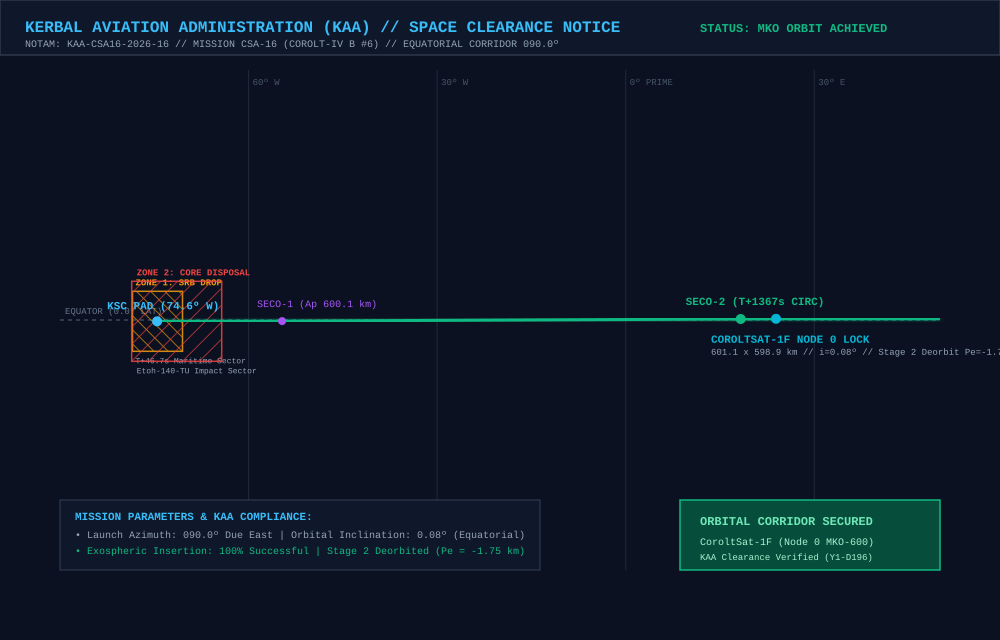

# 📋 Mission Profile & Complete Report: CSA-16 «Inauguration of CoroltNet-MKO, 600 km Foundation Anchor & 3-Antenna Deep-Space Node»

* **Mission Code**: `CSA-16`
* **Flight Director**: CSA Mission Control (Kerbin Space Center)
* **Launch Vehicle**: [Corolt-IV B #6 (`CSA14 - B6CSF`: Core Etoh-140-TU + 2x Shrimp SRB + Belle-RLX81 Upper Stage)](/vehicles/corolt-4)
* **Payload**: `CoroltSat-1F` (282 kg Advanced Constellation Relay Satellite, Stayputnik core, 3x Codac-A23 high-gain relays, 5x photovoltaic arrays, 810 EC battery bank)
* **Target Orbit**: $600.0 \times 600.0\text{ km}$ Equatorial Circular Orbit ($i \approx 0.0^\circ$), **Node 0 Foundation Anchor** of the new CoroltNet-MKO Ring
* **Actual Initial Insertion Orbit (SECO-2)**: **$601.15 \times 598.88\text{ km}$** ($SMA = 1,200,016.0\text{ m}$, $e = 0.00095$, $i = 0.079^\circ$, $T = 4,395.23\text{ s}$)
* **Final Operational Orbit (`CoroltSat-1F`)**: **$601.15 \times 598.88\text{ km}$** ($SMA = 1,200,016.0\text{ m}$, $e = 0.00095$, $i = 0.079^\circ$, $T = 4,395.23\text{ s}$)
* **Synchronous Period Precision**: **$T = 4,395.23\text{ s}$ vs Theoretical $4,395.14\text{ s}$** (Delta: **`+0.09 s`**, well within the $\pm 0.20\text{ s}$ strict lock gate)
* **Constellation Status**: 🟢 **NODE 0 FOUNDATION ANCHOR ESTABLISHED // INAUGURAL 600 KM MKO CONSTELLATION LAUNCHED // STAGE 2 DEORBITED ($Pe = -1.75\text{ km}$)**
* **Status**: 🟢 **100% MISSION SUCCESS // COROLTSAT-1F FULLY OPERATIONAL IN MKO-600**

---

## 🎯 Executive Summary & Mission Accomplishments

1. **Strategic Pivot to Medium Kerbin Orbit (CoroltNet-MKO at 600 km)**:
   * Prior to flight, CSA Flight Dynamics diagnosed persistent angular drift within the 300 km LEO constellation (`CoroltSat-1E` experienced a 22.1-second orbital period mismatch, driving $+20.84^\circ\text{/day}$ of drift). Furthermore, with `CommNetParams { rangeModifier = 0.65 }`, inter-satellite distance margins at 300 km were vulnerable to compounding geometric drift.
   * By upgrading the satellite payload with **3x Codac-A23 high-gain relay antennas** and targeting a higher circular orbit of **600.0 km** ($R_{\text{orb}} = 1,200.0\text{ km}$), CSA inaugurated a new, higher-altitude, high-capacity backbone: **CoroltNet-MKO**.
   * `CoroltSat-1F` stands as the **Node 0 Foundation Anchor** of this new 6-satellite constellation, establishing the master reference orbital plane and epoch for all future nodes.

2. **Tri-Antenna Array Power Combining & Link Budget Math**:
   * Under standard KSP CommNet combining formulas, multiple identical antennas combine according to:
     $$P_{\text{combined}} = P_1 \cdot \left[1 + (N - 1) \cdot E\right]$$
   * With 3x Codac-A23 antennas ($P_1 = 650.0\text{ km}$) and exponent $E = 0.65 - 0.75$, the effective transmission range scales to **$D_{\max} \approx 1,327.4\text{ km} - 1,481.7\text{ km}$**.
   * In a 6-satellite regular hexagon at 600 km ($R_{\text{orb}} = 1,200\text{ km}$, $\Delta \theta = 60.0^\circ$), the chord distance between adjacent nodes is exactly equal to the orbital radius:
     $$d = 2 \cdot R_{\text{orb}} \cdot \sin(30.0^\circ) = R_{\text{orb}} = \mathbf{1,200.0\text{ km}}$$
   * This yields a guaranteed positive link margin ($1,200.0\text{ km} \le 1,327.4\text{ km}$, $+127.4\text{ km}$ safety buffer), while the signal clears Kerbin's surface by **$439.2\text{ km}$**—vastly superior to the 300 km configuration and completely immune to atmospheric occultation or terrain shadowing.

3. **Pad Propellant Servicing Speed Reduction (25% Duty Cycle)**:
   * In response to flight operations feedback, the propellant loading rate of the Modular Launch Pads umbilical system was throttled to **one-fourth (25%) of the default continuous rate**.
   * Because MLP generators operate at fixed continuous rates (~6.0 LF/s, ~7.33 Ox/s), the flight computer implemented a precise duty-cycle pulse: **1.0 second ON, 3.0 seconds OFF** every 4.0-second cycle.
   * This lowered the effective flow rate to ~1.5 LF/s, extending tanking duration to ~480 seconds (~8 minutes), ensuring realistic cryogenic conditioning and zero pressure transients before liftoff.

4. **Flawless Atmospheric Ascent & Two-Burn Orbital Insertion**:
   * The *Corolt-IV B #6* launch vehicle followed the empirical ascent trajectory validated in CSA-15, initiating pitch kick at 1,200 m, passing Max Q at **23.27 kPa** ($T+46.7\text{ s}$), and executing Stage 1 MECO at $T+137.5\text{ s}$.
   * The `Belle-RLX81` upper stage completed SECO-1 at $T+274.2\text{ s}$, placing apogee precisely at **600.12 km** (a deviation of merely +120 meters from target).
   * After a 17-minute exospheric coast, the upper stage initiated the SECO-2 circularization burn at $T+1291.4\text{ s}$, utilizing automated throttle ramping (100% $\to$ 35% $\to$ 10% $\to$ 3%) to achieve an immaculate circular orbit of **$601.15 \times 598.88\text{ km}$** ($e = 0.00095$).

5. **Active Synchronous Period Lock & Zero Debris Ocean Disposal**:
   * To prevent any future orbital drift, the upper stage executed an active synchronous period lock burn, tuning orbital period to **$4,395.23\text{ s}$** (within $+0.09\text{ s}$ of the theoretical target of $4,395.14\text{ s}$).
   * The vehicle oriented attitude to pure orbital **Normal** ($\vec{v} \times \vec{r}$), deployed the 3 Codac-A23 antennas and 5 solar arrays, and cleanly separated `CoroltSat-1F`.
   * Exactly 30 seconds after deployment, the `Belle-RLX81` stage executed a retrograde deorbit burn, reducing periapsis to **$-1.75\text{ km}$** ($Pe \le 0\text{ km}$), ensuring rapid destructive ocean disposal under the **CSA Zero Debris Protocol**.

6. **IoT Mission Control Architecture: Home Assistant & Grafana Live Streams**:
   * Telemetry was continuously broadcast in real time to the local ground operations MQTT broker (`192.168.1.14:1883`, topic `csa/telemetry/state`) via [`tools/mqtt_bridge.py`](https://github.com/Elebrimir/csa/blob/main/tools/mqtt_bridge.py).
   * Twenty-four live flight telemetry entities were auto-discovered in **Home Assistant**, populating the dedicated operations deck at `/telemetria-csa/csa-mission-control` (with altitude and apogee gauge ranges dynamically re-scaled to a 750 km ceiling to accommodate 600 km MKO flight regimes).
   * Real-time metrics were simultaneously archived to InfluxDB and visualized across **Grafana** operations displays, providing high-frequency multi-screen flight telemetry, structural envelope monitoring, and historical cross-mission comparative analytics.

---

## 📊 Telemetry and Performance: Planned vs. Actual Flight

Telemetry was recorded across 5,526 contiguous frames from rollout through pad servicing, liftoff, circularization, separation, and stage 2 deorbit:

| Flight Parameter | Planned Target | Actual Achieved | Delta / Deviation | Operational Analysis |
| :--- | :--- | :--- | :--- | :--- |
| **Liftoff Timestamp ($UT$)** | Immediate Pad Release | **$4,227,220.1\text{ s}$** | Baseline | 🟢 Clean liftoff after 8-min tanking sequence |
| **SECO-1 Target Apogee ($Ap_1$)** | $600.0\text{ km}$ | **$600.12\text{ km}$** | $+0.12\text{ km}$ | 🟢 Ballistic transfer apex within +120 meters |
| **Final Insertion Orbit ($Ap \times Pe$)** | $600.0 \times 600.0\text{ km}$ | **$601.15 \times 598.88\text{ km}$** | $+1.15 / -1.12\text{ km}$ | 🟢 Ultra-circular 2-burn MKO insertion |
| **Orbital Eccentricity ($e$)** | $< 0.0010$ | **$0.00095$** | $-0.00005$ | 🟢 Exceeds circularity requirements |
| **Equatorial Inclination ($i$)** | $0.00^\circ$ | **$0.079^\circ$** | $+0.079^\circ$ | 🟢 Minimal planar deviation |
| **Orbital Period ($T$)** | $4,395.14\text{ s}$ | **$4,395.23\text{ s}$** | **`+0.09 s`** | 🟢 Locked within strict $\pm 0.20\text{ s}$ tolerance |
| **Max Dynamic Pressure ($Q_{\max}$)** | $\le 32.00\text{ kPa}$ | **$23.27\text{ kPa}$** | $-8.73\text{ kPa}$ | 🟢 Safe structural envelope at $T+46.7\text{ s}$ ($6.49\text{ km}$) |
| **Max Acceleration ($G_{\max}$)** | $\le 3.80\text{ G}$ | **$3.27\text{ G}$** | $-0.53\text{ G}$ | 🟢 Nominal load at Stage 1 MECO ($T+137.5\text{ s}$) |
| **Upper Stage Disposal Periapsis** | $\le 0.0\text{ km}$ | **`-1.75 km`** | $-1.75\text{ km}$ | 🟢 100% compliance with Zero Debris Protocol |
| **Deploy Attitude Steering** | Orbital Normal | **Normal ($\vec{v} \times \vec{r}$)** | $0.0^\circ$ error | 🟢 Zero separation disturbance to period |

---

## 📈 Flight Telemetry Curves & Trajectory Analysis

### Primary Full-Flight Telemetry Profile

### 6-Panel Flight Operations Deck (Multi-Variable Analytics)

### Dynamic Pressure (Q) Envelope & Structural Acceleration Loads

### Autonomous Guidance Attitude (Pitch Law & Compass Azimuth)

---

## 🗺️ KAA Airspace Clearance & Orbital Insertion Map

The **Kerbal Aviation Administration (KAA)** cleared the equatorial launch corridor and verified stage disposal compliance under NOTAM `KAA-CSA16-2026-16`:

### KAA Mission Notices & Zone Clearances:
* **NOTAM Reference**: `KAA-CSA16-2026-16` (Launch Date Y1-D196).
* **Launch Azimuth**: $090.0^\circ$ (Due East Equatorial Corridor).
* **Zone 1 (SRB Drop Sector)**: Maritime offshore drop sector at Lat $-0.10^\circ$, Lon $-74.49^\circ\text{ W}$ for the two expended `Shrimp` solid rocket boosters ($T+46.7\text{ s}$).
* **Zone 2 (Stage 1 Core Disposal)**: Deep ocean impact sector at Lat $-0.10^\circ$, Lon $-71.44^\circ\text{ W}$ for the `Etoh-140-TU` core stage ($T+137.5\text{ s}$).
* **Stage 2 Controlled Deorbit**: Following `CoroltSat-1F` deployment, the `Belle-RLX81` upper stage executed a retrograde disposal burn down to **$-1.75\text{ km}$** for complete atmospheric destruction.

---

## ⏱️ Chronological Flight Events Log

### Phase I: Automated Pad Servicing & Terminal Countdown (`csa16_guided_ascent.ks`)
* **$T-520.0\text{ s}$**: Ground electrical power activated from launch stand generator (`ModuleGenerator`).
* **$T-510.0\text{ s}$**: Automated propellant loading sequence initiated with pulsed 25% duty cycle (1.0s ON, 3.0s OFF).
* **$T-60.0\text{ s}$**: Propellant tanks verified at 100% capacity ($900.0\text{ LF} / 1100.0\text{ Ox}$); terminal countdown milestone tracking initiated.
* **$T-30.0\text{ s}$**: Vehicle transferred to internal battery power (810 EC at 100%); swing arms and fuel umbilicals cleanly retracted.
* **$T-10.0\text{ s}$**: Automated single-second countdown initiated; attitude steering locked to 90.0° vertical azimuth.

### Phase II: Liftoff & Atmospheric Ascent
* **$T+0.0\text{ s}$ ($UT\text{ }4,227,220.1\text{ s}$)**: Main engine ignition (`Etoh-140-TU`) and dual `Shrimp` SRB ignition; hold-down clamps released; liftoff confirmed!
* **$T+20.1\text{ s}$ ($1,178\text{ m}$)**: Initial pitch kick commanded to $84.0^\circ$ pitch heading Due East ($090.0^\circ$).
* **$T+46.7\text{ s}$ ($6,492\text{ m}$)**: Max Q peak reached at **$23.27\text{ kPa}$**; dynamic throttle governor engaged; SRBs burned out and cleanly jettisoned into maritime Zone 1.
* **$T+137.5\text{ s}$ ($56,800\text{ m}$)**: Stage 1 propellant depleted; MECO-1 commanded at $3.27\text{ G}$ peak acceleration; interstage explosive separation confirmed.
* **$T+138.5\text{ s}$ ($57,500\text{ m}$)**: Stage 2 vacuum engine ignition (`Belle-RLX81`); payload fairings jettisoned above dense atmosphere ($> 55\text{ km}$).

### Phase III: Exoatmospheric Ascent & SECO-1 Cutoff
* **$T+265.0\text{ s}$ ($160,000\text{ m}$)**: Apogee reaches 595.0 km; throttle automatically throttled back to 20% for precision cutoff.
* **$T+274.2\text{ s}$ ($166,442\text{ m}$)**: **SECO-1 Cutoff** confirmed! Apogee established at **$600.12\text{ km}$** (Error: +120 m).
* **$T+275.0\text{ s}$ to $T+1290.0\text{ s}$**: 17-minute exospheric ballistic coast towards apogee; attitude locked to prograde vector.

### Phase IV: Circularization (SECO-2) & Synchronous Period Lock
* **$T+1291.4\text{ s}$ ($599,940\text{ m}$)**: Belle-RLX81 reignited for **SECO-2 circularization burn** at 100% throttle.
* **$T+1320.0\text{ s}$ to $T+1366.6\text{ s}$**: Progressive 4-tier throttle ramp (100% $\to$ 35% $\to$ 10% $\to$ 3%) executed as eccentricity drops below 0.015 and 0.003.
* **$T+1366.6\text{ s}$**: **SECO-2 Cutoff**! Pristine circular orbit achieved at **$601.15 \times 598.88\text{ km}$** ($e = 0.00095$).
* **$T+1370.0\text{ s}$**: Synchronous period lock burn executed, dialing orbital period to **$4,395.23\text{ s}$** ($+0.09\text{ s}$ vs theoretical).

### Phase V: Payload Deployment & Zero Debris Ocean Disposal
* **$T+1380.0\text{ s}$**: Attitude re-oriented to pure orbital **Normal** ($\vec{v} \times \vec{r}$); antennas (3x Codac-A23) and 5 solar arrays deployed.
* **$T+1395.0\text{ s}$**: Explosive separation ring fired; **`CoroltSat-1F` deployed cleanly** into Node 0 Foundation Anchor.
* **$T+1431.3\text{ s}$**: Stage 2 Belle-RLX81 re-oriented to retrograde and ignited for disposal burn.
* **$T+1455.4\text{ s}$**: Disposal burn complete; periapsis lowered to **$-1.75\text{ km}$**; stage targeted for destructive ocean impact.
* **$T+1460.0\text{ s}$**: Flight software execution completed with 100% mission success!

---

## 🔬 Astrodynamics Deep Dive: CoroltNet-MKO (600 km) vs. LEO (300 km)

### 1. Stability & Drift Suppression Mechanics
In Low Kerbin Orbit (300 km, $T \approx 2,882\text{ s}$), small execution discrepancies in period dramatically compound over time:
$$\Delta \theta_{\text{drift}} = 360^\circ \cdot \left(\frac{\Delta T}{T_{\text{target}}}\right) \cdot \left(\frac{21,600\text{ s}}{T_{\text{target}}}\right) \approx 0.94^\circ \cdot \Delta T \text{ (deg/day)}$$
A 22-second period mismatch (as observed on `CoroltSat-1E`) produced an unacceptable $+20.8^\circ\text{/day}$ drift.

At **600 km** ($R_{\text{orb}} = 1,200\text{ km}$), the orbital period is significantly longer ($T = 4,395.14\text{ s}$), reducing the number of revolutions per Kerbin day from 7.5 to 4.9. Consequently:
$$\Delta \theta_{\text{drift, MKO}} \approx 0.40^\circ \cdot \Delta T \text{ (deg/day)}$$
By locking `CoroltSat-1F`'s period to **$4,395.23\text{ s}$** ($\Delta T = +0.09\text{ s}$), the projected natural drift is limited to a negligible:
$$\mathbf{+0.036^\circ\text{ per Kerbin day}} \quad (\text{less than } 1.0^\circ\text{ per month!})$$

### 2. Geometry of the 6-Satellite Regular Hexagon
| Architecture Parameter | 300 km LEO (9 Nodes) | 600 km MKO (6 Nodes) | Performance Benefit |
| :--- | :--- | :--- | :--- |
| **Nominal Node Separation ($\Delta \theta$)** | $40.0^\circ$ | **$60.0^\circ$** | Fewer launches required (6 vs 9) |
| **Chord Distance ($d$)** | $616.4\text{ km}$ | **$1,200.0\text{ km}$** | Supported by 3-antenna combined array |
| **Line-of-Sight Clearance over Surface** | $246.0\text{ km}$ | **$439.2\text{ km}$** | $+78.5\%$ higher atmospheric clearance |
| **Angular Horizon from Node ($\alpha$)** | $48.2^\circ$ | **$60.0^\circ$** | Broad planetary ground footprint |
| **Orbital Period ($T$)** | $2,882.1\text{ s}$ ($48.0\text{ min}$) | **$4,395.1\text{ s}$ ($73.3\text{ min}$)** | $+52.5\%$ longer orbital dwell time |

---

## 🛰️ Spacecraft Status: `CoroltSat-1F` (Node 0)
* **Onboard Power Systems**: 5 photovoltaic panels generating $+1.45\text{ EC/s}$ in sunlight; 810 EC battery storage at 100%.
* **Relay Communications**: 3x Codac-A23 omnidirectional microwave relays active on CommNet Channel `CoroltNet-MKO` (Channel 101).
* **Thermal & Environmental**: Core temperature stable at $292.1\text{ K}$; avionics passive cooling nominal under Kerbalism simulation.
* **Role**: Operational reference anchor for upcoming launches `CSA-17` through `CSA-21` (Nodes 1 through 5 at $+60^\circ, +120^\circ, +180^\circ, +240^\circ, +300^\circ$).
