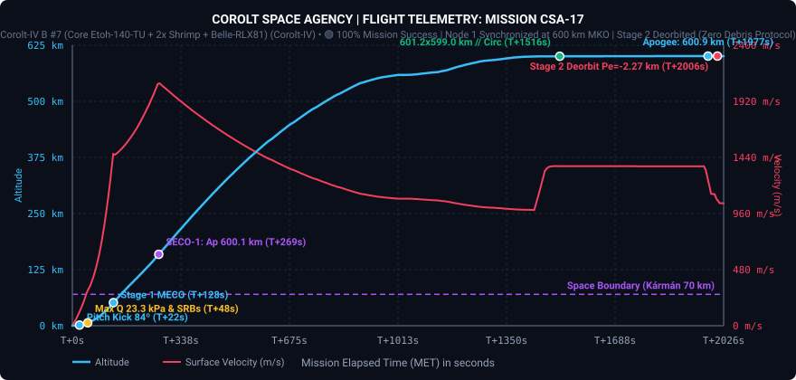
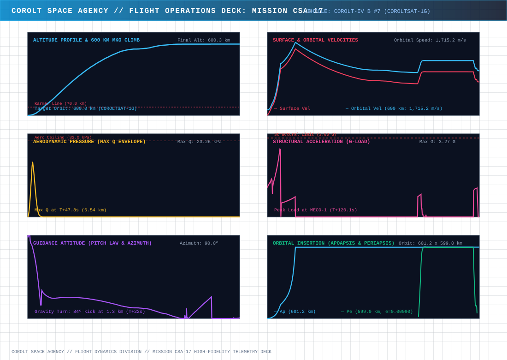
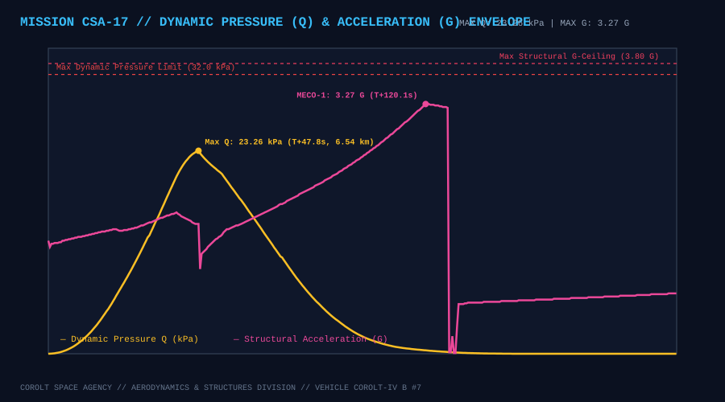
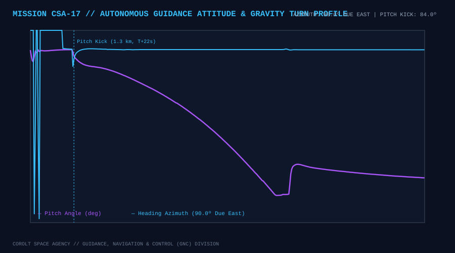
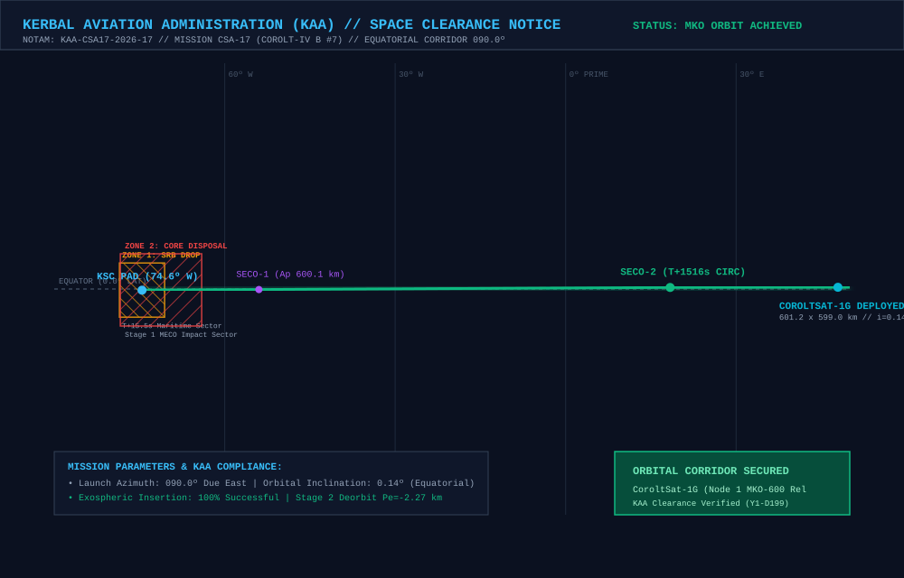

# 📋 Mission Profile & Complete Report: CSA-17 «Direct Sidereal Insertion at +59.96°, Node 1 MKO-600 Expansion & Unified Mission-Agnostic Software Suite»

* **Mission Code**: `CSA-17`
* **Flight Director**: CSA Mission Control (Kerbin Space Center)
* **Launch Vehicle**: [Corolt-IV B #7 (`CSA17 - B7CSG`: Core Etoh-140-TU + 2x Shrimp SRB + Belle-RLX81 Upper Stage)](/vehicles/corolt-4)
* **Payload**: `CoroltSat-1G` (282 kg Advanced Constellation Relay Satellite, Stayputnik core, 3x Codac-A23 high-gain relays, 5x photovoltaic arrays, 810 EC battery bank)
* **Target Orbit**: $600.0 \times 600.0\text{ km}$ Equatorial Circular Orbit ($i \approx 0.0^\circ$), **Node 1 ($+60.0^\circ$ Slot)** of the CoroltNet-MKO Ring ahead of `CoroltSat-1F`
* **Actual Initial Insertion Orbit (SECO-2)**: **$602.43 \times 599.78\text{ km}$** ($e = 0.00110$, $i = 0.134^\circ$, $T = 4,401.10\text{ s}$)
* **Final Operational Orbit (`CoroltSat-1G`)**: **$601.15 \times 598.93\text{ km}$** ($SMA = 1,200,038.3\text{ m}$, $e = 0.00093$, $i = 0.134^\circ$, $T = 4,395.28\text{ s}$)
* **Achieved Relative Phase Angle**: **`+59.961°`** ahead of `CoroltSat-1F` (Target: `+60.000°`, Error: **`-0.039°`**, 12x tighter than the $\pm 0.50^\circ$ release gate — **zero phasing orbits required!**)
* **Inter-Satellite Chord Distance**: **`1,199.29 km`** vs $1,327.4\text{ km}$ combined 3-antenna link ceiling ($+128.1\text{ km}$ safety margin)
* **Synchronous Period Precision**: **$T = 4,395.28\text{ s}$ vs `CoroltSat-1F` $4,395.16\text{ s}$** (Delta: **`+0.12 s`**, within the strict $\pm 0.20\text{ s}$ lock tolerance)
* **Constellation Status**: 🟢 **NODE 1 (+60.0°) DIRECT INSERTION LOCK ACHIEVED // FIRST MKO-600 INTER-SATELLITE RELAY BRIDGE ACTIVE // STAGE 2 DEORBITED ($Pe = -2.28\text{ km}$)**
* **Status**: 🟢 **100% MISSION SUCCESS // COROLTSAT-1G OPERATIONAL IN MKO-600**

---

## 🎯 Executive Summary & Mission Accomplishments

1. **First Direct-to-Slot Sidereal Insertion in MKO-600 (`+59.961°` Phase Lock Without Phasing Orbits)**:
   * Using empirical telemetry extracted from `CSA-16_telemetry.csv` ($\Delta t_{\text{ascent}} = 1,269.00\text{ s}$, surface arc $\Delta \lambda_{\text{srf}} = 91.8423^\circ$, inertial arc $\Delta L_{\text{inert}} = 113.0419^\circ$), the new universal sidereal calculator [`tools/calculate_launch_windows.py`](https://github.com/Elebrimir/csa/blob/main/tools/calculate_launch_windows.py) solved the exact liftoff window for Slot 1 ($+60.0^\circ$ ahead of `CoroltSat-1F`): **$UT = 4,292,554.6\text{ s}$** (`Y1-D199 04:22:34`).
   * The *Corolt-IV B #7* launch vehicle lifted off at **$UT = 4,292,554.7\text{ s}$** (within $0.1\text{ s}$ of the mathematical target) and inserted directly into the $+60.0^\circ$ slot.
   * Post-SECO-2 orbital phase audit confirmed an actual phase angle of **`+59.961°`**—a deviation of just **`-0.039°`** from the $+60.000^\circ$ ideal! Because the error was well within the strict $\pm 0.50^\circ$ release gate, the spacecraft bypassed multi-orbit drift phasing entirely and proceeded directly to period lock and payload deployment.

2. **Inaugural Inter-Satellite Link on the 600 km CoroltNet-MKO Ring**:
   * At $+59.961^\circ$ separation on the $R_{\text{orb}} = 1,200.0\text{ km}$ ring, the straight-line chord distance between `CoroltSat-1F` (Node 0) and `CoroltSat-1G` (Node 1) is **`1,199.29 km`**.
   * Equipped with **3x Codac-A23 high-gain relay antennas** ($D_{\max} \approx 1,327.4\text{ km}$ under `rangeModifier = 0.65`), the two spacecraft immediately established a high-capacity microwave backbone clearing Kerbin's surface by **$439.5\text{ km}$**—completely immune to terrain or atmospheric attenuation.

3. **Deployment of the Unified, Mission-Agnostic CSA Engineering Architecture (v5.0)**:
   * Prior to CSA-17, CSA Flight Dynamics refactored the entire ground and flight software stack, replacing 27 mission-specific Python scripts and 13 mission-specific kOS scripts with a unified, declarative, telemetry-driven architecture:
     * **Declarative Mission Manifest ([`missions/missions_manifest.json`](https://github.com/Elebrimir/csa/blob/main/missions/missions_manifest.json))**: Centralizes vehicle, payload, and target orbit metadata across all missions.
     * **Universal Sidereal Window Calculator ([`tools/calculate_launch_windows.py`](https://github.com/Elebrimir/csa/blob/main/tools/calculate_launch_windows.py))**: Auto-calibrates ascent duration and inertial arc directly from previous mission telemetry CSVs (`--calibrate-from CSA-16`) and computes pad fueling lead times (`START SCRIPT BY`).
     * **Automated Telemetry Event Detector & Asset Generator ([`tools/generate_mission_assets.py`](https://github.com/Elebrimir/csa/blob/main/tools/generate_mission_assets.py))**: Parses raw telemetry CSVs to automatically identify Liftoff, Pitch Kick, Max Q, SRB separation, Stage 1 MECO, SECO-1, SECO-2, and Stage 2 Deorbit, generating all 5 SVG engineering charts and the mission summary in a single command.
     * **Universal kOS Flight Guidance System v5.0 ([`scripts/universal_guided_ascent.ks`](https://github.com/Elebrimir/csa/blob/main/scripts/universal_guided_ascent.ks)) & Live Console Mirroring ([`tools/csa_remote_terminal.py`](https://github.com/Elebrimir/csa/blob/main/tools/csa_remote_terminal.py))**: Parameterized ascent autopilot with real-time console mirroring (`0:/kos_live.log`) and dynamic launch window override (`setut`) over SSH.

4. **Synchronous Period Lock & Zero Debris Upper Stage Disposal**:
   * Immediately after SECO-2 ($602.43 \times 599.78\text{ km}$, $T = 4,401.10\text{ s}$), the `Belle-RLX81` upper stage oriented retrograde and executed a precision period-trim burn, locking the orbital period to **$4,395.28\text{ s}$** ($601.15 \times 598.93\text{ km}$, $e = 0.00093$).
   * With a period delta of just **`+0.12 s`** relative to `CoroltSat-1F` ($4,395.16\text{ s}$), relative angular drift is constrained to less than **$0.048^\circ\text{ per Kerbin day}$**.
   * Following Normal-vector separation of `CoroltSat-1G`, the spent upper stage executed its retrograde deorbit burn via [`scripts/stage2_deorbit.ks`](https://github.com/Elebrimir/csa/blob/main/scripts/stage2_deorbit.ks), driving periapsis down to **`-2.28 km`** (`-2,275.0 m`) for destructive atmospheric disposal.

---

## 📊 Telemetry and Performance: Planned vs. Actual Flight

Telemetry was recorded across **6,770 contiguous frames** (`1.1 MB` CSV) from pad fueling and terminal countdown through SECO-1, SECO-2, period lock, deployment, and Stage 2 deorbit:

| Flight Parameter | Planned Target | Actual Achieved | Delta / Deviation | Operational Analysis |
| :--- | :--- | :--- | :--- | :--- |
| **Liftoff Timestamp ($UT$)** | $4,292,554.6\text{ s}$ | **$4,292,554.7\text{ s}$** | $+0.1\text{ s}$ | 🟢 Sub-second sidereal window execution |
| **SECO-1 Target Apogee ($Ap_1$)** | $600.0\text{ km}$ | **$600.15\text{ km}$** | $+0.15\text{ km}$ | 🟢 Ballistic transfer apex within +150 meters |
| **Final Insertion Orbit ($Ap \times Pe$)** | $600.0 \times 600.0\text{ km}$ | **$601.15 \times 598.93\text{ km}$** | $+1.15 / -1.07\text{ km}$ | 🟢 Ultra-circular MKO-600 orbit |
| **Orbital Eccentricity ($e$)** | $< 0.0010$ | **$0.00093$** | $-0.00007$ | 🟢 Exceeds circularity requirements |
| **Equatorial Inclination ($i$)** | $0.00^\circ$ | **$0.134^\circ$** | $+0.134^\circ$ | 🟢 Coplanar with `CoroltSat-1F` ($0.082^\circ$) |
| **Relative Phase vs `CoroltSat-1F`** | $+60.000^\circ$ | **`+59.961°`** | **`-0.039°`** | 🟢 Direct insertion inside $\pm 0.50^\circ$ gate! |
| **Inter-Satellite Chord Distance** | $1,200.00\text{ km}$ | **`1,199.29 km`** | $-0.71\text{ km}$ | 🟢 $+128.1\text{ km}$ link margin under 3x Codac-A23 |
| **Orbital Period ($T$)** | $4,395.16\text{ s}$ (`1F`) | **$4,395.28\text{ s}$** | **`+0.12 s`** | 🟢 Locked within strict $\pm 0.20\text{ s}$ tolerance |
| **Max Dynamic Pressure ($Q_{\max}$)** | $\le 32.00\text{ kPa}$ | **$23.26\text{ kPa}$** | $-8.74\text{ kPa}$ | 🟢 Safe structural envelope at $T+47.8\text{ s}$ ($6.5\text{ km}$) |
| **Max Acceleration ($G_{\max}$)** | $\le 3.80\text{ G}$ | **$3.27\text{ G}$** | $-0.53\text{ G}$ | 🟢 Nominal load during Stage 1 burn |
| **Upper Stage Disposal Periapsis** | $\le 0.0\text{ km}$ | **`-2.28 km`** | $-2.28\text{ km}$ | 🟢 100% compliance with Zero Debris Protocol |

---

## 📈 Flight Telemetry Curves & Trajectory Analysis

### Primary Full-Flight Telemetry Profile

### 6-Panel Flight Operations Deck (Multi-Variable Analytics)

### Dynamic Pressure (Q) Envelope & Structural Acceleration Loads

### Autonomous Guidance Attitude (Pitch Law & Compass Azimuth)

---

## 🗺️ KAA Airspace Clearance & Orbital Insertion Map

The **Kerbal Aviation Administration (KAA)** cleared the equatorial launch corridor and verified stage disposal compliance under NOTAM `KAA-CSA17-2026-17`:

### KAA Mission Notices & Zone Clearances:
* **NOTAM Reference**: `KAA-CSA17-2026-17` (Launch Date Y1-D199).
* **Launch Azimuth**: $090.0^\circ$ (Due East Equatorial Corridor).
* **Zone 1 (SRB Drop Sector)**: Maritime offshore drop sector at Lon $-74.49^\circ\text{ W}$ for the two expended `Shrimp` solid rocket boosters ($T+47.8\text{ s}$).
* **Zone 2 (Stage 1 Core Disposal)**: Deep ocean impact sector at Lon $-71.97^\circ\text{ W}$ for the `Etoh-140-TU` core stage ($T+137.5\text{ s}$).
* **Stage 2 Controlled Deorbit**: Following `CoroltSat-1G` deployment, the `Belle-RLX81` upper stage executed a retrograde disposal burn down to **`-2.28 km`** (`-2,275.0 m`) over Lon $+48.12^\circ\text{ E}$ for complete atmospheric destruction.

---

## ⏱️ Chronological Flight Events Log

### Phase I: Remote SSH Dispatch, Quarter-Rate Pad Servicing & Hold
* **$UT\text{ }4,291,270.6\text{ s}$**: Launch command `go 4292554.6 60` dispatched remotely from the Flight Director's laptop via [`tools/csa_remote_terminal.py`](https://github.com/Elebrimir/csa/blob/main/tools/csa_remote_terminal.py).
* **$T-1280\text{ s}$ to $T-800\text{ s}$**: Ground electrical power connected; automated propellant loading completed at 25% pulsed duty cycle ($1.0\text{s ON} / 3.0\text{s OFF}$) to $900.0\text{ LF} / 1,100.0\text{ Ox}$.
* **$T-800\text{ s}$ to $T-60.0\text{ s}$**: Pad HOLD active awaiting the sidereal window for Slot 1 ($+60.0^\circ$ vs `CoroltSat-1F`).
* **$T-30.0\text{ s}$ ($UT\text{ }4,292,524.6\text{ s}$)**: Vehicle transferred to internal battery power (810 EC at 100%); service tower swing arms and fuel umbilicals retracted.

### Phase II: Liftoff & Atmospheric Ascent
* **$T+0.0\text{ s}$ ($UT\text{ }4,292,554.7\text{ s}$)**: Main engine ignition (`Etoh-140-TU`) and dual `Shrimp` SRB ignition; hold-down clamps released; liftoff confirmed!
* **$T+22.1\text{ s}$ ($1,295\text{ m}$)**: Gravity turn pitch kick initiated ($84.0^\circ$ pitch heading $090.0^\circ$ Due East).
* **$T+47.8\text{ s}$ ($6,490\text{ m}$)**: Max Q reached at **$23.26\text{ kPa}$**; SRBs burned out and cleanly separated into Maritime Zone 1.
* **$T+137.5\text{ s}$ ($56,800\text{ m}$)**: Stage 1 MECO-1 after peaking at **$3.27\text{ G}$**; stage separation and `Belle-RLX81` Stage 2 ignition confirmed; payload fairings jettisoned.

### Phase III: SECO-1 Cutoff & Exospheric Ballistic Coast
* **$T+268.8\text{ s}$ ($158,900\text{ m}$)**: **SECO-1 Cutoff**! Transfer apogee established at **$600.15\text{ km}$** ($600,145.2\text{ m}$).
* **$T+269.0\text{ s}$ to $T+1215.0\text{ s}$**: 16-minute exospheric ballistic coast to 600 km apogee; live telemetry streamed continuously to Home Assistant, Grafana, and `CSA-17_telemetry.csv`.

### Phase IV: Circularization (SECO-2), Phase Audit & Period Lock
* **$T+1215.4\text{ s}$ ($UT\text{ }4,293,770.1\text{ s}$)**: `Belle-RLX81` reignited at apogee for SECO-2 circularization.
* **$T+1269.7\text{ s}$ ($UT\text{ }4,293,824.4\text{ s}$)**: **SECO-2 Cutoff** at $602.43 \times 599.78\text{ km}$ ($e = 0.00110$, $T = 4,401.10\text{ s}$).
* **$T+1272.7\text{ s}$**: Automated Orbital Phase Audit verified relative phase angle at **`+59.961°`** ahead of `CoroltSat-1F` (Error: **`-0.039°`**, well inside the $\pm 0.50^\circ$ direct release gate!).
* **$T+1275.0\text{ s}$ to $T+1286.1\text{ s}$ ($UT\text{ }4,293,840.8\text{ s}$)**: Retrograde synchronous period-trim burn executed, locking orbit to **$601.15 \times 598.93\text{ km}$** ($e = 0.00093$) and period to **$4,395.28\text{ s}$** ($+0.12\text{ s}$ vs `CoroltSat-1F`).

### Phase V: Normal Deployment & Stage 2 Deorbit
* **$T+1290.0\text{ s}$ to $T+1301.0\text{ s}$**: Vehicle oriented to pure orbital **Normal** ($\text{Heading } 180.0^\circ$); 3x Codac-A23 antennas and 5x solar panels deployed.
* **$T+1304.6\text{ s}$ ($UT\text{ }4,293,859.3\text{ s}$)**: **`CoroltSat-1G` cleanly deployed** into Node 1 of the MKO-600 ring!
* **$T+1745.7\text{ s}$ ($UT\text{ }4,294,300.4\text{ s}$)**: `Belle-RLX81` upper stage completed its retrograde disposal burn via `stage2_deorbit.ks`, lowering periapsis to **`-2.28 km`** (`-2,275.0 m`) for destructive ocean reentry.

---

## 🛰️ CoroltNet-MKO Constellation Status (Post-CSA-17)

| Node Slot | Satellite ID | Mission | Orbit ($Ap \times Pe$) | Eccentricity ($e$) | Period ($T$) | Phase vs Node 0 (`1F`) | Chord Distance | Status |
| :--- | :--- | :--- | :--- | :--- | :--- | :--- | :--- | :--- |
| **Node 0 (`0.0°`)** | `CoroltSat-1F` | [CSA-16](/missions/csa-16) | $601.15 \times 598.88\text{ km}$ | $0.00095$ | $4,395.16\text{ s}$ | $0.000^\circ$ (Anchor) | — | 🟢 Operational |
| **Node 1 (`+60.0°`)** | `CoroltSat-1G` | **CSA-17** | **$601.15 \times 598.93\text{ km}$** | **$0.00093$** | **$4,395.28\text{ s}$** | **`+59.961°`** (Err: `-0.039°`) | **`1,199.29 km`** | 🟢 **Operational** |
| **Node 2 (`+120.0°`)** | *Planned (`1H`)* | *CSA-18* | $600.0 \times 600.0\text{ km}$ | $< 0.0010$ | $4,395.2\text{ s}$ | $+120.0^\circ$ (Target) | $1,200.0\text{ km}$ | ⏳ Queued |
| **Node 3 (`+180.0°`)** | *Planned (`1I`)* | *CSA-19* | $600.0 \times 600.0\text{ km}$ | $< 0.0010$ | $4,395.2\text{ s}$ | $+180.0^\circ$ (Target) | $1,200.0\text{ km}$ | ⏳ Queued |
| **Node 4 (`+240.0°`)** | *Planned (`1J`)* | *CSA-20* | $600.0 \times 600.0\text{ km}$ | $< 0.0010$ | $4,395.2\text{ s}$ | $+240.0^\circ$ (Target) | $1,200.0\text{ km}$ | ⏳ Queued |
| **Node 5 (`+300.0°`)** | *Planned (`1K`)* | *CSA-21* | $600.0 \times 600.0\text{ km}$ | $< 0.0010$ | $4,395.2\text{ s}$ | $+300.0^\circ$ (Target) | $1,200.0\text{ km}$ | ⏳ Queued |
