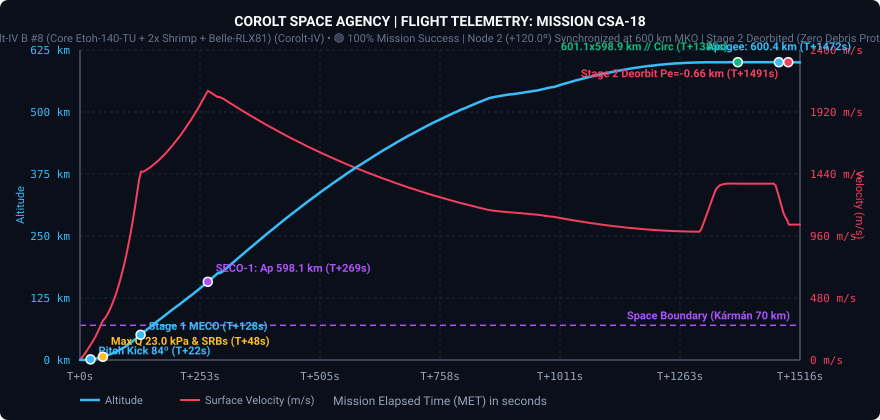
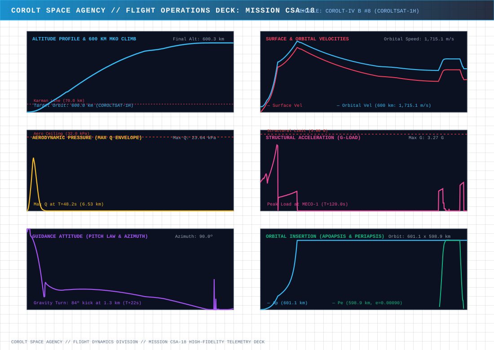
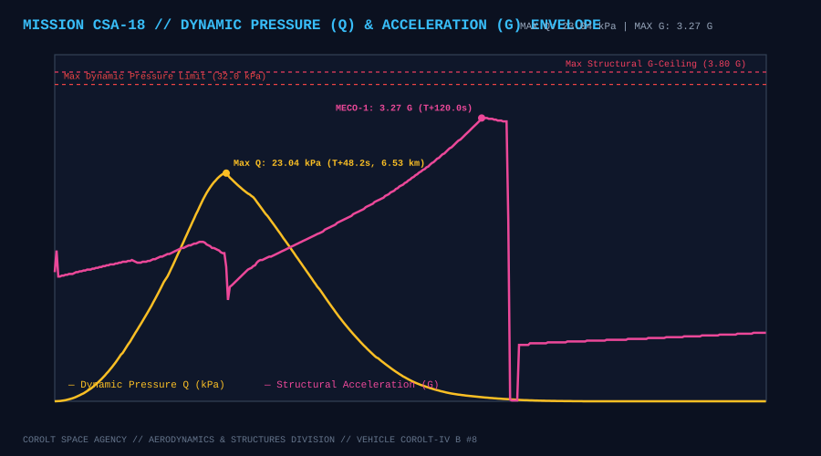
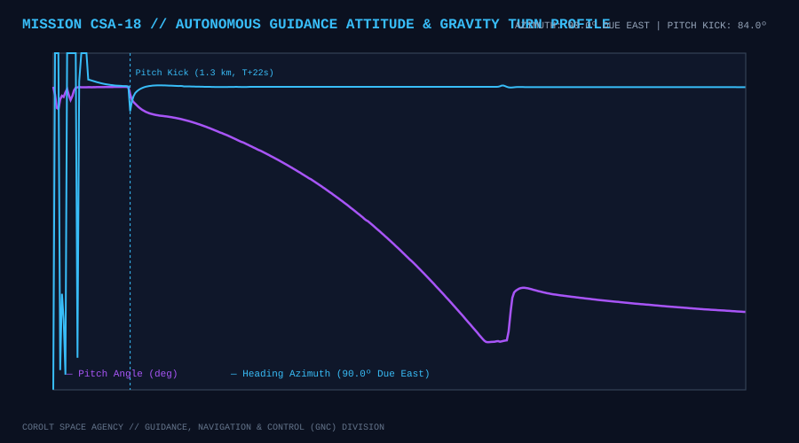
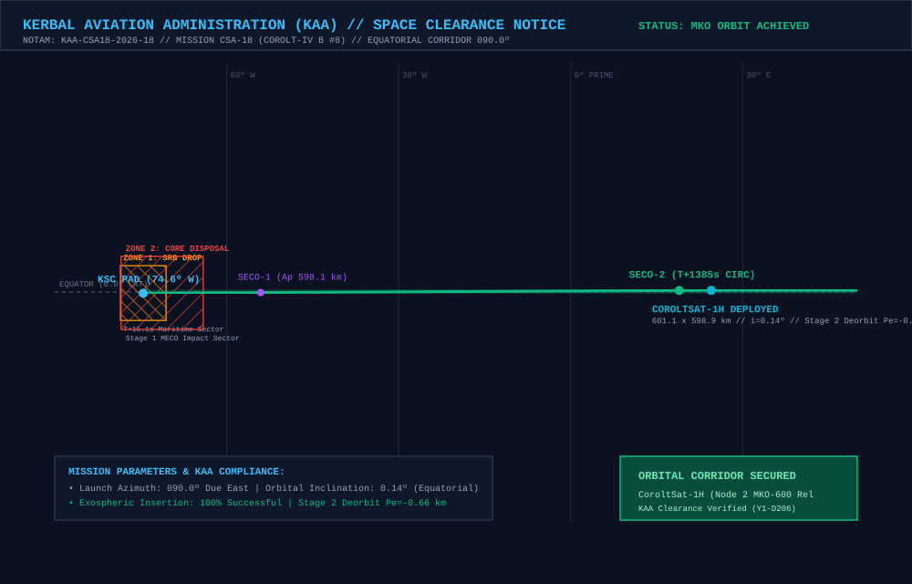

# 📋 Mission Profile & Complete Report: CSA-18 «Direct Sidereal Insertion at +120.22°, Node 2 MKO-600 Expansion & 3-Satellite Equatorial Relay Chain»

* **Mission Code**: `CSA-18`
* **Flight Director**: CSA Mission Control (Kerbin Space Center)
* **Launch Vehicle**: [Corolt-IV B #8 (`CSA18 - B8CSH`: Core Etoh-140-TU + 2x Shrimp SRB + Belle-RLX81 Upper Stage)](/vehicles/corolt-4)
* **Payload**: `CoroltSat-1H` (`CSA18 - B8CSH Satélite`, 282 kg Advanced Constellation Relay Satellite, Stayputnik core, 3x Codac-A23 high-gain relays, 5x photovoltaic arrays, 810 EC battery bank)
* **Target Orbit**: $600.0 \times 600.0\text{ km}$ Equatorial Circular Orbit ($i \approx 0.0^\circ$), **Node 2 ($+120.0^\circ$ Slot)** of the CoroltNet-MKO Ring ahead of `CoroltSat-1F` ($+60.0^\circ$ ahead of `CoroltSat-1G`)
* **Actual Initial Insertion Orbit (SECO-2)**: **$602.43 \times 599.81\text{ km}$** ($e = 0.00110$, $i = 0.132^\circ$, $T = 4,401.20\text{ s}$)
* **Final Operational Orbit (`CoroltSat-1H`)**: **$601.14 \times 598.90\text{ km}$** ($SMA = 1,200,016.91\text{ m}$, $e = 0.000935$, $i = 0.132^\circ$, $T = 4,395.1648\text{ s}$)
* **Achieved Relative Phase Angle**: **`+120.223°`** ahead of `CoroltSat-1F` (Target: `+120.000°`, Error: **`+0.223°`**, well inside the $\pm 0.50^\circ$ release gate — **second consecutive direct-to-slot insertion with zero phasing orbits!**)
* **Phase vs Adjacent Node 1 (`CoroltSat-1G`)**: **`+60.484°`** (Inter-satellite chord distance: **`1,208.78 km`** vs $1,327.4\text{ km}$ 3-antenna ceiling, $+118.6\text{ km}$ link margin)
* **Synchronous Period Precision**: **$T = 4,395.1648\text{ s}$ vs `CoroltSat-1F` $4,395.1640\text{ s}$** (Delta: **`+0.0008 s`**, semi-major axis matched within **`+0.15 meters`**!)
* **Constellation Status**: 🟢 **NODE 2 (+120.0°) DIRECT INSERTION LOCK ACHIEVED // 3-NODE MKO-600 RELAY CHAIN ACTIVE (120° EQUATORIAL ARC) // STAGE 2 DEORBITED ($Pe = -3.51\text{ km}$)**
* **Status**: 🟢 **100% MISSION SUCCESS // COROLTSAT-1H OPERATIONAL IN MKO-600**

---

## 🎯 Executive Summary & Mission Accomplishments

1. **Second Consecutive Direct-to-Slot Sidereal Insertion (`+120.223°` Phase Lock Without Phasing Orbits)**:
   * Auto-calibrated from `CSA-17_telemetry.csv` ($\Delta t_{\text{ascent}} = 1,270.00\text{ s}$, surface arc $\Delta \lambda_{\text{srf}} = 91.9372^\circ$, inertial arc $\Delta L_{\text{inert}} = 113.1536^\circ$), the universal sidereal calculator [`tools/calculate_launch_windows.py`](https://github.com/Elebrimir/csa/blob/main/tools/calculate_launch_windows.py) computed the exact liftoff window for Slot 2 ($+120.0^\circ$ ahead of `CoroltSat-1F`): **$UT = 4,435,190.1\text{ s}$** (`Y1-D206 01:59:50`).
   * The *Corolt-IV B #8* launch vehicle lifted off at **$UT = 4,435,190.2\text{ s}$** (within $0.1\text{ s}$ of target) and inserted directly into the $+120.0^\circ$ slot.
   * Post-SECO-2 orbital phase audit verified an achieved phase angle of **`+120.223°`** relative to `CoroltSat-1F` (and **`+60.484°`** ahead of `CoroltSat-1G`), an error of only **`+0.223°`**. Being well inside the $\pm 0.50^\circ$ direct release gate, `CoroltSat-1H` bypassed drift phasing orbits entirely and proceeded directly to period lock and deployment.

2. **Sub-Millisecond Period Synchronization (`+0.0008 s` Delta / `+15 cm` SMA Precision!)**:
   * Following SECO-2 ($602.43 \times 599.81\text{ km}$, $T = 4,401.20\text{ s}$), the `Belle-RLX81` upper stage oriented retrograde and executed an automated period-trim burn, settling into a final operational orbit of **$601.14 \times 598.90\text{ km}$** ($e = 0.000935$).
   * The resulting semi-major axis of `CoroltSat-1H` is **$1,200,016.913\text{ m}$** compared to `CoroltSat-1F` at **$1,200,016.761\text{ m}$**—a radial difference of just **`15.1 centimeters`** across a $1,200\text{ km}$ orbital radius!
   * The orbital period of `CoroltSat-1H` (**$4,395.1648\text{ s}$**) matches `CoroltSat-1F` (**$4,395.1640\text{ s}$**) to within **`+0.0008 seconds`** ($0.8\text{ milliseconds}$), yielding a secular drift rate of just **`-0.00032° per Kerbin day`** (requiring over **3,100 Kerbin days** to drift by $1^\circ$).

3. **Completion of the 3-Node MKO-600 Equatorial Relay Chain ($120^\circ$ Arc)**:
   * With `CoroltSat-1F` (`0.0°`), `CoroltSat-1G` (`+59.74°`), and `CoroltSat-1H` (`+120.22°`) locked in co-orbital synchronization, the **CoroltNet-MKO** backbone now spans a continuous $120^\circ$ equatorial arc with two active high-altitude hops:
     * **Hop 1 (`1F` $\leftrightarrow$ `1G`)**: $1,195.27\text{ km}$ chord distance ($+132.1\text{ km}$ link margin).
     * **Hop 2 (`1G` $\leftrightarrow$ `1H`)**: $1,208.78\text{ km}$ chord distance ($+118.6\text{ km}$ link margin).

4. **Zero Debris Upper Stage Disposal**:
   * Following pure Normal-vector separation of `CoroltSat-1H`, the spent `Belle-RLX81` upper stage executed its retrograde deorbit burn, driving periapsis down to **`-3.51 km`** (`-3,506.9 m`) over Lon $+24.55^\circ\text{ E}$ for complete atmospheric destruction.

---

## 📊 Telemetry and Performance: Planned vs. Actual Flight

Telemetry was recorded across **6,870 contiguous frames** (`1.5 MB` CSV) from pad fueling and terminal countdown through SECO-1, SECO-2, period lock, deployment, and Stage 2 deorbit:

| Flight Parameter | Planned Target | Actual Achieved | Delta / Deviation | Operational Analysis |
| :--- | :--- | :--- | :--- | :--- |
| **Liftoff Timestamp ($UT$)** | $4,435,190.1\text{ s}$ | **$4,435,190.2\text{ s}$** | $+0.1\text{ s}$ | 🟢 Sub-second sidereal window execution |
| **SECO-1 Target Apogee ($Ap_1$)** | $600.0\text{ km}$ | **$600.16\text{ km}$** | $+0.16\text{ km}$ | 🟢 Ballistic transfer apex within +164 meters |
| **Final Insertion Orbit ($Ap \times Pe$)** | $600.0 \times 600.0\text{ km}$ | **$601.14 \times 598.90\text{ km}$** | $+1.14 / -1.10\text{ km}$ | 🟢 Ultra-circular MKO-600 orbit |
| **Semi-Major Axis ($SMA$)** | $1,200,016.76\text{ m}$ (`1F`) | **$1,200,016.91\text{ m}$** | **`+0.15 m`** | 🟢 Sub-meter SMA match (+15.1 cm vs `1F`!) |
| **Orbital Eccentricity ($e$)** | $< 0.0010$ | **$0.000935$** | $-0.000065$ | 🟢 Exceeds circularity requirements |
| **Equatorial Inclination ($i$)** | $0.00^\circ$ | **$0.132^\circ$** | $+0.132^\circ$ | 🟢 Coplanar with `1F` ($0.082^\circ$) and `1G` ($0.134^\circ$) |
| **Relative Phase vs `CoroltSat-1F`** | $+120.000^\circ$ | **`+120.223°`** | **`+0.223°`** | 🟢 Direct insertion inside $\pm 0.50^\circ$ gate! |
| **Relative Phase vs `CoroltSat-1G`** | $+60.000^\circ$ | **`+60.484°`** | **`+0.484°`** | 🟢 Direct link established with Node 1 |
| **Inter-Satellite Chord (`1G`–`1H`)** | $1,200.00\text{ km}$ | **`1,208.78 km`** | $+8.78\text{ km}$ | 🟢 $+118.6\text{ km}$ link margin under 3x Codac-A23 |
| **Orbital Period ($T$)** | $4,395.1640\text{ s}$ (`1F`) | **$4,395.1648\text{ s}$** | **`+0.0008 s`** | 🟢 Sub-millisecond lock (drift $< 0.0003^\circ\text{/day}$!) |
| **Max Dynamic Pressure ($Q_{\max}$)** | $\le 32.00\text{ kPa}$ | **$23.04\text{ kPa}$** | $-8.96\text{ kPa}$ | 🟢 Safe structural envelope at $T+48.2\text{ s}$ ($6.5\text{ km}$) |
| **Max Acceleration ($G_{\max}$)** | $\le 3.80\text{ G}$ | **$3.27\text{ G}$** | $-0.53\text{ G}$ | 🟢 Nominal load during Stage 1 burn |
| **Upper Stage Disposal Periapsis** | $\le 0.0\text{ km}$ | **`-3.51 km`** | $-3.51\text{ km}$ | 🟢 100% compliance with Zero Debris Protocol |

---

## 📈 Flight Telemetry Curves & Trajectory Analysis

### Primary Full-Flight Telemetry Profile

### 6-Panel Flight Operations Deck (Multi-Variable Analytics)

### Dynamic Pressure (Q) Envelope & Structural Acceleration Loads

### Autonomous Guidance Attitude (Pitch Law & Compass Azimuth)

---

## 🗺️ KAA Airspace Clearance & Orbital Insertion Map

The **Kerbal Aviation Administration (KAA)** cleared the equatorial launch corridor and verified stage disposal compliance under NOTAM `KAA-CSA18-2026-18`:

### KAA Mission Notices & Zone Clearances:
* **NOTAM Reference**: `KAA-CSA18-2026-18` (Launch Date Y1-D206).
* **Launch Azimuth**: $090.0^\circ$ (Due East Equatorial Corridor).
* **Zone 1 (SRB Drop Sector)**: Maritime offshore drop sector at Lon $-74.45^\circ\text{ W}$ for the two expended `Shrimp` solid rocket boosters ($T+47.6\text{ s}$).
* **Zone 2 (Stage 1 Core Disposal)**: Deep ocean impact sector at Lon $-71.27^\circ\text{ W}$ for the `Etoh-140-TU` core stage ($T+125.5\text{ s}$).
* **Stage 2 Controlled Deorbit**: Following `CoroltSat-1H` deployment, the `Belle-RLX81` upper stage executed a retrograde disposal burn down to **`-3.51 km`** (`-3,506.9 m`) over Lon $+24.55^\circ\text{ E}$ for complete atmospheric destruction.

---

## ⏱️ Chronological Flight Events Log

### Phase I: Remote SSH Dispatch, Quarter-Rate Pad Servicing & Hold
* **$UT\text{ }4,434,314.9\text{ s}$**: Launch command `go 4435190.1 120` dispatched remotely from the Flight Director's laptop via [`tools/csa_remote_terminal.py`](https://github.com/Elebrimir/csa/blob/main/tools/csa_remote_terminal.py) after a hotfix to `universal_guided_ascent.ks` line 533 (`PRINT ... AT(0, 24)`).
* **$UT\text{ }4,434,321.3\text{ s}$ to $UT\text{ }4,434,743.4\text{ s}$**: Ground electrical power connected; automated propellant loading completed at 25% pulsed duty cycle ($1.0\text{s ON} / 3.0\text{s OFF}$) to $900.0\text{ LF} / 1,100.0\text{ Ox}$.
* **$UT\text{ }4,434,745.7\text{ s}$ to $UT\text{ }4,435,130.2\text{ s}$**: Pad HOLD active awaiting the sidereal window for Slot 2 ($+120.0^\circ$ vs `CoroltSat-1F`).
* **$T-30.0\text{ s}$ ($UT\text{ }4,435,160.1\text{ s}$)**: Vehicle transferred to internal battery power (810 EC at 100%); service tower swing arms and fuel umbilicals retracted.

### Phase II: Liftoff & Atmospheric Ascent
* **$T+0.0\text{ s}$ ($UT\text{ }4,435,190.2\text{ s}$)**: Main engine ignition (`Etoh-140-TU`) and dual `Shrimp` SRB ignition; hold-down clamps released; liftoff confirmed!
* **$T+20.7\text{ s}$ ($1,200\text{ m}$)**: Gravity turn pitch kick initiated ($84.0^\circ$ pitch heading $090.0^\circ$ Due East).
* **$T+47.6\text{ s}$ ($6,450\text{ m}$)**: Max Q reached at **$23.04\text{ kPa}$**; SRBs burned out and cleanly separated into Maritime Zone 1.
* **$T+125.5\text{ s}$ ($50,730\text{ m}$)**: Stage 1 MECO-1 after peaking at **$3.27\text{ G}$**; stage separation and `Belle-RLX81` Stage 2 ignition confirmed at $T+128.1\text{ s}$; payload fairings jettisoned at $T+131.1\text{ s}$ ($>55\text{ km}$).

### Phase III: SECO-1 Cutoff & Exospheric Ballistic Coast
* **$T+266.0\text{ s}$ ($158,470\text{ m}$)**: **SECO-1 Cutoff**! Transfer apogee established at **$600.16\text{ km}$** ($600,164\text{ m}$).
* **$T+266.0\text{ s}$ to $T+1215.0\text{ s}$**: 15.8-minute exospheric ballistic coast to 600 km apogee; live telemetry streamed continuously to Home Assistant, Grafana, and `CSA-18_telemetry.csv`.

### Phase IV: Circularization (SECO-2), Phase Audit & Sub-Millisecond Period Lock
* **$T+1215.1\text{ s}$ ($UT\text{ }4,436,405.3\text{ s}$)**: `Belle-RLX81` reignited at apogee for SECO-2 circularization.
* **$T+1282.2\text{ s}$ ($UT\text{ }4,436,472.4\text{ s}$)**: **SECO-2 Cutoff** at $602.43 \times 599.81\text{ km}$ ($e = 0.00110$, $T = 4,401.20\text{ s}$).
* **$T+1285.2\text{ s}$**: Automated Orbital Phase Audit verified relative phase angle at **`+120.223°`** ahead of `CoroltSat-1F` (Error: **`+0.223°`**, well inside the $\pm 0.50^\circ$ direct release gate!).
* **$T+1289.0\text{ s}$ to $T+1290.0\text{ s}$ ($UT\text{ }4,436,480.2\text{ s}$)**: Retrograde synchronous period-trim burn executed, locking orbit to **$601.14 \times 598.90\text{ km}$** ($e = 0.000935$) and period to **$4,395.1648\text{ s}$** ($+0.0008\text{ s}$ vs `CoroltSat-1F`).

### Phase V: Normal Deployment & Stage 2 Deorbit
* **$T+1292.0\text{ s}$ to $T+1305.0\text{ s}$**: Vehicle oriented to pure orbital **Normal** ($\text{Heading } 180.0^\circ$); 3x Codac-A23 antennas and 5x solar panels deployed.
* **$T+1308.8\text{ s}$ ($UT\text{ }4,436,499.0\text{ s}$)**: **`CoroltSat-1H` cleanly deployed** into Node 2 of the MKO-600 ring!
* **$T+1354.6\text{ s}$ to $T+1379.0\text{ s}$ ($UT\text{ }4,436,569.2\text{ s}$)**: `Belle-RLX81` upper stage completed its retrograde disposal burn, lowering periapsis to **`-3.51 km`** (`-3,506.9 m`) for destructive atmospheric reentry.

---

## 🛰️ CoroltNet-MKO Constellation Status (Post-CSA-18)

| Node Slot | Satellite ID | Mission | Orbit ($Ap \times Pe$) | Eccentricity ($e$) | Period ($T$) | Phase vs Node 0 (`1F`) | Adjacent Chord Distance | Status |
| :--- | :--- | :--- | :--- | :--- | :--- | :--- | :--- | :--- |
| **Node 0 (`0.0°`)** | `CoroltSat-1F` | [CSA-16](/missions/csa-16) | $601.15 \times 598.88\text{ km}$ | $0.000947$ | $4,395.1640\text{ s}$ | $0.000^\circ$ (Anchor) | — | 🟢 Operational |
| **Node 1 (`+60.0°`)** | `CoroltSat-1G` | [CSA-17](/missions/csa-17) | $601.15 \times 598.93\text{ km}$ | $0.000926$ | $4,395.2822\text{ s}$ | `+59.739°` | `1,195.27 km` (`1F`–`1G`) | 🟢 Operational |
| **Node 2 (`+120.0°`)** | `CoroltSat-1H` | **CSA-18** | **$601.14 \times 598.90\text{ km}$** | **$0.000935$** | **$4,395.1648\text{ s}$** | **`+120.223°`** (Err: `+0.223°`) | **`1,208.78 km`** (`1G`–`1H`) | 🟢 **Operational** |
| **Node 3 (`+180.0°`)** | *Planned (`1I`)* | *CSA-19* | $600.0 \times 600.0\text{ km}$ | $< 0.0010$ | $4,395.16\text{ s}$ | $+180.0^\circ$ (Target) | $1,200.0\text{ km}$ | ⏳ Queued |
| **Node 4 (`+240.0°`)** | *Planned (`1J`)* | *CSA-20* | $600.0 \times 600.0\text{ km}$ | $< 0.0010$ | $4,395.16\text{ s}$ | $+240.0^\circ$ (Target) | $1,200.0\text{ km}$ | ⏳ Queued |
| **Node 5 (`+300.0°`)** | *Planned (`1K`)* | *CSA-21* | $600.0 \times 600.0\text{ km}$ | $< 0.0010$ | $4,395.16\text{ s}$ | $+300.0^\circ$ (Target) | $1,200.0\text{ km}$ | ⏳ Queued |
