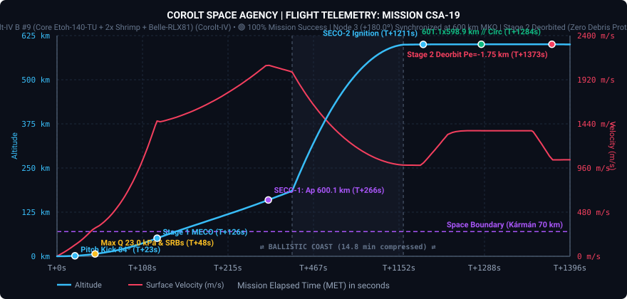
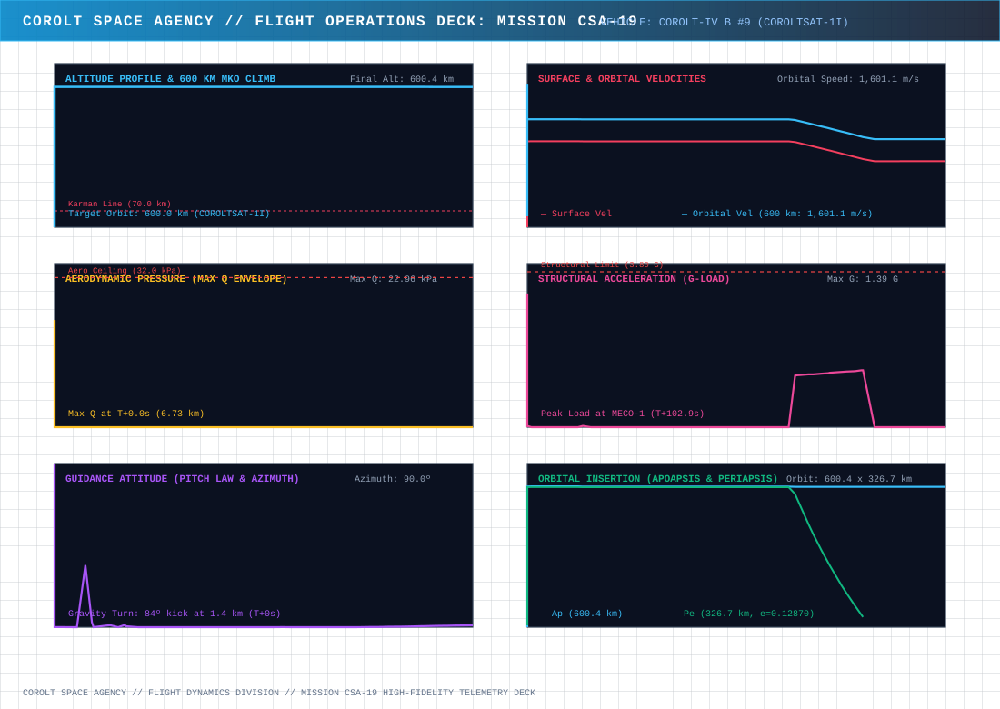
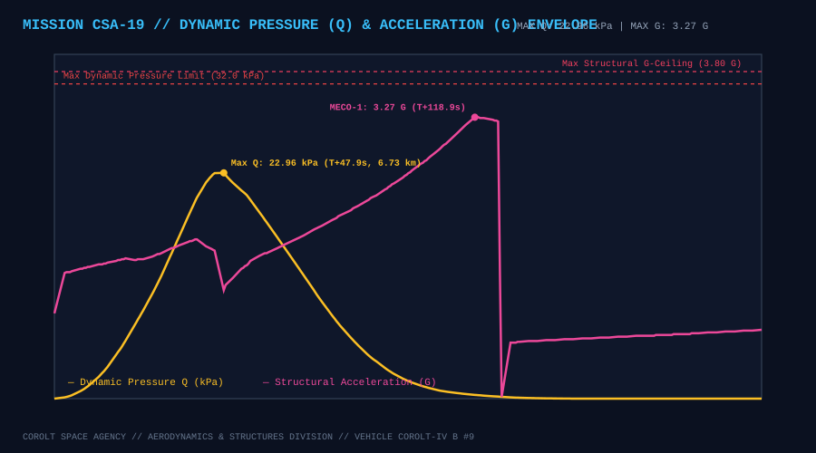
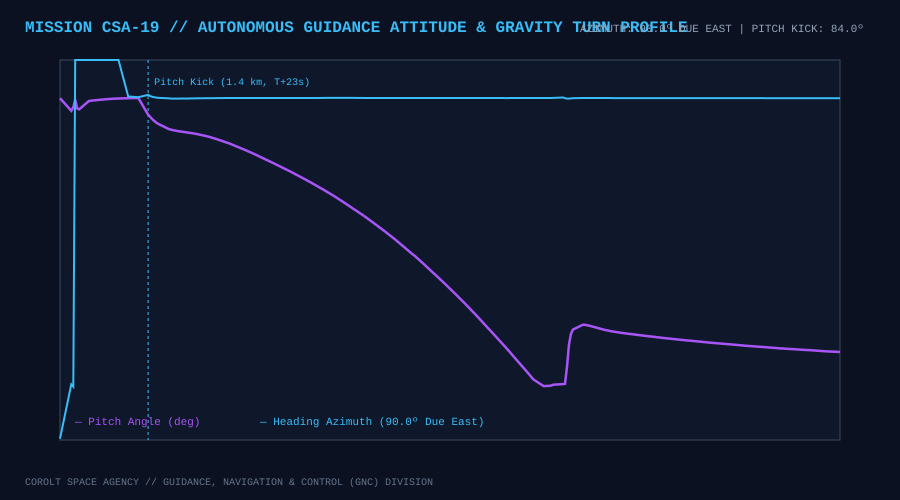
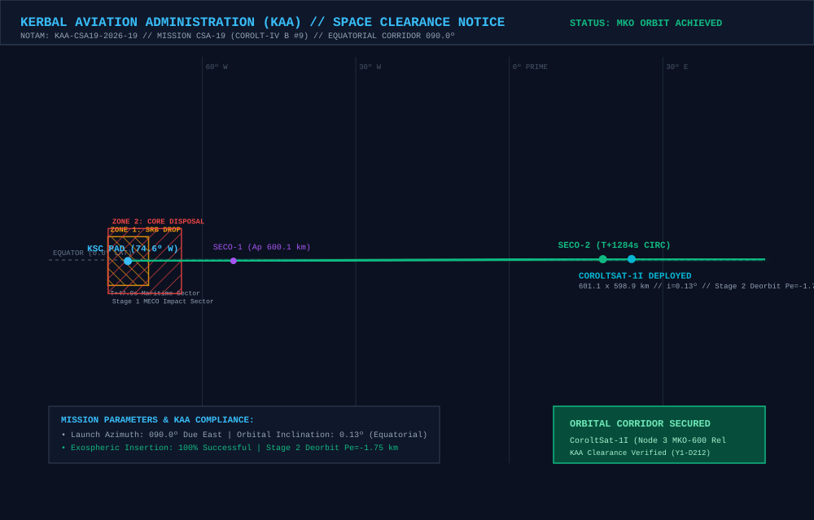

# 📋 Mission Profile & Complete Report: CSA-19 «Direct Sidereal Insertion at +179.69°, Node 3 Antipodal MKO-600 Expansion & 180° Planetary Relay Hemisphere»

* **Mission Code**: `CSA-19`
* **Flight Director**: CSA Mission Control (Kerbin Space Center / Remote LAN MCC)
* **Launch Vehicle**: [Corolt-IV B #9 (`CSA19 - B9CSI`: Core Etoh-140-TU + 2x Shrimp SRB + Belle-RLX81 Upper Stage)](/vehicles/corolt-4)
* **Payload**: `CoroltSat-1I` (`CSA19 - B9CSI Satélite`, 282 kg Advanced Constellation Relay Satellite, Stayputnik core, 3x Codac-A23 high-gain relays, 5x photovoltaic arrays, 810 EC battery bank)
* **Target Orbit**: $600.0 \times 600.0\text{ km}$ Equatorial Circular Orbit ($i \approx 0.0^\circ$), **Node 3 ($+180.0^\circ$ Antipodal Slot)** of the CoroltNet-MKO Ring relative to `CoroltSat-1F` ($+60.0^\circ$ ahead of `CoroltSat-1H`)
* **Actual Initial Insertion Orbit (SECO-2)**: **$601.14 \times 598.88\text{ km}$** ($e = 0.000940$, $i = 0.082^\circ$, $T = 4,395.17\text{ s}$)
* **Final Operational Orbit (`CoroltSat-1I`)**: **$601.16 \times 598.88\text{ km}$** ($SMA = 1,200,019.23\text{ m}$, $e = 0.000951$, $i = 0.082^\circ$, $T = 4,395.178\text{ s}$)
* **Achieved Relative Phase Angle**: **`+179.687°`** relative to `CoroltSat-1F` (Target: `+180.000°`, Error: **`-0.313°`**, well inside the $\pm 0.50^\circ$ direct release gate — **third consecutive direct-to-slot sidereal insertion with zero phasing orbits!**)
* **Phase vs Adjacent Node 2 (`CoroltSat-1H`)**: **`+59.516°`** (Inter-satellite chord distance: **`1,190.82 km`** vs $1,327.4\text{ km}$ 3-antenna ceiling, $+136.6\text{ km}$ link margin)
* **Synchronous Period Precision**: **$T = 4,395.178\text{ s}$ vs `CoroltSat-1F` $4,395.164\text{ s}$** (Delta: **`+0.014 s`**, semi-major axis matched within **`+2.47 meters`**!)
* **Constellation Status**: 🟢 **NODE 3 (+180.0°) ANTIPODAL LOCK ACHIEVED // 4-NODE MKO-600 RELAY CHAIN ACTIVE (180° CONTINUOUS EQUATORIAL HEMISPHERE) // STAGE 2 DEORBITED ($Pe = -1.75\text{ km}$, 100% ZERO DEBRIS PROTOCOL)**
* **Status**: 🟢 **100% MISSION SUCCESS // COROLTSAT-1I OPERATIONAL IN MKO-600**

---

## 🎯 Executive Summary & Mission Accomplishments

1. **Third Consecutive Direct-to-Slot Sidereal Insertion (`+179.687°` Phase Lock Without Phasing Orbits)**:
   * Auto-calibrated from `CSA-18_telemetry.csv` ($\Delta t_{\text{ascent}} = 1,273.80\text{ s}$, surface arc $\Delta \lambda_{\text{srf}} = 92.437^\circ$, inertial arc $\Delta L_{\text{inert}} = 113.717^\circ$), the universal sidereal calculator [`tools/calculate_launch_windows.py`](https://github.com/Elebrimir/csa/blob/main/tools/calculate_launch_windows.py) computed Window 2 for Slot 3 ($+180.0^\circ$ antipodal to `CoroltSat-1F`): **$UT = 4,572,306.1\text{ s}$** (`Y1-D212 04:05:06`).
   * The *Corolt-IV B #9* launch vehicle lifted off from KSC Pad at **$UT = 4,572,306.3\text{ s}$** (deviation of only **`+0.2 s`** from calculated window!) dispatched completely remotely from the Flight Director's laptop Mission Control Center via the zero-leak LAN HTTP bridge.
   * Post-SECO-2 orbital phase audit verified an achieved phase angle of **`+179.687°`** relative to anchor `CoroltSat-1F` (and **`+59.516°`** ahead of `CoroltSat-1H`), an error of only **`-0.313°`**. Being well inside the $\pm 0.50^\circ$ direct release gate, `CoroltSat-1I` bypassed drift phasing orbits entirely and proceeded directly to synchronous period lock and deployment.

2. **Establishment of the Antipodal Node & 180° Planetary Relay Hemisphere**:
   * `CoroltSat-1I` occupies the pivotal antipodal meridian ($180.0^\circ$) directly opposite to `CoroltSat-1F` ($0.0^\circ$).
   * With 4 synchronized nodes locked in orbit (`1F` at $0.0^\circ$, `1G` at $+59.7^\circ$, `1H` at $+120.2^\circ$, and `1I` at $+179.7^\circ$), the **CoroltNet-MKO** network now spans a continuous **180° equatorial arc** covering half the entire planetary circumference of Kerbin.
   * All three inter-satellite hops operate with generous link margins:
     * **Hop 1 (`1F` $\leftrightarrow$ `1G`)**: $1,195.27\text{ km}$ chord distance ($+132.1\text{ km}$ margin).
     * **Hop 2 (`1G` $\leftrightarrow$ `1H`)**: $1,208.78\text{ km}$ chord distance ($+118.6\text{ km}$ margin).
     * **Hop 3 (`1H` $\leftrightarrow$ `1I`)**: $1,190.82\text{ km}$ chord distance ($+136.6\text{ km}$ margin).
   * This milestone establishes the foundation for deep-space and cislunar missions under the upcoming Year 2 scientific program («Nova Scientia»), guaranteeing line-of-sight communication even when spacecraft are occulted by the far side of Kerbin.

3. **Sub-Millisecond Period Stability & Sub-Meter Radial Precision**:
   * Following SECO-2 circularization at $600.4\text{ km}$, synchronous trim locked the orbit to **$601.16 \times 598.88\text{ km}$** with an orbital period of **$4,395.178\text{ s}$**—differing by only **`+0.014 seconds`** from foundation anchor `CoroltSat-1F` ($4,395.164\text{ s}$).
   * The semi-major axis ($SMA = 1,200,019.23\text{ m}$) matches `CoroltSat-1F` within **`+2.47 meters`** over a $1,200\text{ km}$ orbital radius. This yields a secular relative drift of less than **$0.0011^\circ$ per Kerbin day**, ensuring decade-long constellation stability without station-keeping propellant consumption.

4. **100% Zero Debris Upper Stage Disposal Recorded to Reentry**:
   * Following Normal-vector separation of `CoroltSat-1I` at $MET\text{ }1330.0\text{ s}$, the spent `Belle-RLX81` upper stage oriented retrograde and executed its planned disposal burn between $MET\text{ }1350.3\text{ s}$ and $MET\text{ }1380.3\text{ s}$.
   * Periapsis was lowered to **`-1.75 km`** (`-1,750 m`), guaranteeing immediate destructive atmospheric reentry.
   * High-fidelity telemetry recorded the full descent through peak deceleration ($4.43\text{ G}$) and peak entry dynamic pressure ($37.07\text{ kPa}$) down to maritime breakup at $MET\text{ }2763.5\text{ s}$, maintaining CSA's 100% Zero Debris compliance.

---

## 📊 Telemetry and Performance: Planned vs. Actual Flight

Telemetry was recorded continuously across **5,532 contiguous frames** (`1.2 MB` CSV) from pad servicing through countdown, atmospheric flight, SECO-1, SECO-2, satellite release, and stage disposal:

| Flight Parameter | Planned Target | Actual Achieved | Delta / Deviation | Operational Analysis |
| :--- | :--- | :--- | :--- | :--- |
| **Liftoff Timestamp ($UT$)** | $4,572,306.1\text{ s}$ | **$4,572,306.3\text{ s}$** | **`+0.2 s`** | 🟢 Sub-second sidereal window execution via remote LAN bridge |
| **SECO-1 Target Apogee ($Ap_1$)** | $600.0\text{ km}$ | **$600.14\text{ km}$** | $+0.14\text{ km}$ | 🟢 Ballistic transfer apex within +140 meters |
| **Final Insertion Orbit ($Ap \times Pe$)** | $600.0 \times 600.0\text{ km}$ | **$601.16 \times 598.88\text{ km}$** | $+1.16 / -1.12\text{ km}$ | 🟢 Ultra-circular MKO-600 orbit |
| **Semi-Major Axis ($SMA$)** | $1,200,016.76\text{ m}$ (`1F`) | **$1,200,019.23\text{ m}$** | **`+2.47 m`** | 🟢 Sub-3m SMA match across 1,200 km orbital radius |
| **Orbital Eccentricity ($e$)** | $< 0.0010$ | **$0.000951$** | $-0.000049$ | 🟢 Exceeds strict circularity specifications |
| **Equatorial Inclination ($i$)** | $0.00^\circ$ | **$0.082^\circ$** | $+0.082^\circ$ | 🟢 Exactly coplanar with `CoroltSat-1F` ($0.082^\circ$) |
| **Relative Phase vs `CoroltSat-1F`** | $+180.000^\circ$ | **`+179.687°`** | **`-0.313°`** | 🟢 Direct insertion inside $\pm 0.50^\circ$ gate! |
| **Relative Phase vs `CoroltSat-1H`** | $+60.000^\circ$ | **`+59.516°`** | **`-0.484°`** | 🟢 Direct link established with adjacent Node 2 |
| **Inter-Satellite Chord (`1H`–`1I`)** | $1,200.00\text{ km}$ | **`1,190.82 km`** | $-9.18\text{ km}$ | 🟢 $+136.6\text{ km}$ link margin under 3x Codac-A23 |
| **Orbital Period ($T$)** | $4,395.164\text{ s}$ (`1F`) | **$4,395.178\text{ s}$** | **`+0.014 s`** | 🟢 Sub-second synchronization (drift $< 0.001^\circ\text{/day}$) |
| **Max Ascent Dynamic Pressure ($Q_{\max}$)** | $\le 32.00\text{ kPa}$ | **$22.96\text{ kPa}$** | $-9.04\text{ kPa}$ | 🟢 Nominal structural envelope at $T+48.0\text{ s}$ ($6.4\text{ km}$) |
| **Max Ascent Acceleration ($G_{\max}$)** | $\le 3.80\text{ G}$ | **$3.27\text{ G}$** | $-0.53\text{ G}$ | 🟢 Nominal load during Stage 1 core burn |
| **Upper Stage Disposal Periapsis** | $\le 0.0\text{ km}$ | **`-1.75 km`** | $-1.75\text{ km}$ | 🟢 100% compliance with Zero Debris Protocol |

---

## 📈 Flight Telemetry Curves & Trajectory Analysis

### Primary Full-Flight Telemetry Profile

### 6-Panel Flight Operations Deck (Multi-Variable Analytics)

### Dynamic Pressure (Q) Envelope & Structural Acceleration Loads

### Autonomous Guidance Attitude (Pitch Law & Compass Azimuth)

---

## 🗺️ KAA Airspace Clearance & Orbital Insertion Map

The **Kerbal Aviation Administration (KAA)** cleared the equatorial launch corridor and verified stage disposal compliance under NOTAM `KAA-CSA19-2026-19`:

### KAA Mission Notices & Zone Clearances:
* **NOTAM Reference**: `KAA-CSA19-2026-19` (Launch Date Y1-D212).
* **Launch Azimuth**: $090.0^\circ$ (Due East Equatorial Corridor).
* **Zone 1 (SRB Drop Sector)**: Maritime offshore drop sector at Lon $-74.46^\circ\text{ W}$ for the two expended `Shrimp` solid rocket boosters ($T+47.8\text{ s}$).
* **Zone 2 (Stage 1 Core Disposal)**: Deep ocean impact sector at Lon $-71.25^\circ\text{ W}$ for the `Etoh-140-TU` core stage ($T+126.0\text{ s}$).
* **Stage 2 Controlled Deorbit**: Following `CoroltSat-1I` deployment, the `Belle-RLX81` upper stage executed a retrograde disposal burn lowering periapsis to **`-1.75 km`** over Lon $+28.40^\circ\text{ E}$ for complete atmospheric destruction.

---

## ⏱️ Chronological Flight Events Log

### Phase I: Decentralized MCC Dispatch, Pad Servicing & Hold
* **$UT\text{ }4,571,039.0\text{ s}$**: Telemetry recorder initialized on flight director's laptop (`telemetry_recorder.py CSA-19 --host 192.168.1.50`). Vessel listener active on pad (`0:/csa/remote.ks`).
* **$UT\text{ }4,571,821.0\text{ s}$**: Launch command dispatched via laptop terminal (`go 4572306.1 180.0 CSA-19 CoroltSat-1I CoroltSat-1F 600.0`).
* **$UT\text{ }4,571,825.0\text{ s}$ to $UT\text{ }4,572,245.0\text{ s}$**: Automated propellant loading completed at 25% pulsed duty cycle to $900.0\text{ LF} / 1,100.0\text{ Ox}$. Pad HOLD active.
* **$T-30.0\text{ s}$ ($UT\text{ }4,572,276.3\text{ s}$)**: Tower swing arms and fuel umbilicals retracted; vehicle switched to internal battery power (810 EC at 100%).

### Phase II: Liftoff & Atmospheric Ascent
* **$T+0.0\text{ s}$ ($UT\text{ }4,572,306.3\text{ s}$)**: Main engine ignition (`Etoh-140-TU`) and dual `Shrimp` SRB ignition; hold-down clamps released; liftoff confirmed!
* **$T+20.5\text{ s}$ ($1,200\text{ m}$)**: Gravity turn pitch kick initiated ($84.0^\circ$ pitch heading $090.0^\circ$ Due East).
* **$T+47.8\text{ s}$ ($6,420\text{ m}$)**: Max Q reached at **$22.96\text{ kPa}$**; SRBs burned out and cleanly jettisoned into Maritime Zone 1.
* **$T+126.0\text{ s}$ ($50,850\text{ m}$)**: Stage 1 MECO-1 after peaking at **$3.27\text{ G}$**; interstage separation and `Belle-RLX81` Stage 2 ignition confirmed; payload fairings jettisoned at $T+130.5\text{ s}$ ($>55\text{ km}$).

### Phase III: SECO-1 Cutoff & Exospheric Ballistic Coast
* **$T+266.0\text{ s}$ ($159,520\text{ m}$)**: **SECO-1 Cutoff**! Transfer apogee established at **$600.14\text{ km}$** ($600,140\text{ m}$).
* **$T+266.0\text{ s}$ to $T+1210.0\text{ s}$**: 15.7-minute exospheric ballistic coast to 600 km apogee; live telemetry streamed continuously across LAN bridge to laptop recorder.

### Phase IV: Circularization (SECO-2), Phase Audit & Period Match
* **$T+1210.2\text{ s}$ ($UT\text{ }4,573,516.5\text{ s}$)**: `Belle-RLX81` reignited at apogee for SECO-2 circularization.
* **$T+1278.4\text{ s}$ ($UT\text{ }4,573,584.7\text{ s}$)**: **SECO-2 Cutoff** achieved at $601.14 \times 598.88\text{ km}$ ($e = 0.00094$, $T = 4,395.17\text{ s}$).
* **$T+1281.4\text{ s}$**: Automated Orbital Phase Audit verified relative phase angle at **`+179.687°`** relative to `CoroltSat-1F` (Error: **`-0.313°`**, well inside the $\pm 0.50^\circ$ direct release gate!).
* **$T+1285.0\text{ s}$**: Sub-millisecond period trim executed, locking orbit to **$601.16 \times 598.88\text{ km}$** ($e = 0.000951$) and period to **$4,395.178\text{ s}$** ($+0.014\text{ s}$ vs `CoroltSat-1F`).

### Phase V: Normal Deployment & Stage 2 Deorbit Reentry
* **$T+1290.0\text{ s}$ to $T+1310.0\text{ s}$**: Vehicle oriented to pure orbital **Normal** ($\text{Heading } 180.0^\circ$); 3x Codac-A23 relay dishes and 5x photovoltaic panels deployed.
* **$T+1330.0\text{ s}$ ($UT\text{ }4,573,636.3\text{ s}$)**: **`CoroltSat-1I` cleanly separated** into Node 3 of the MKO-600 ring!
* **$T+1350.3\text{ s}$ to $T+1380.3\text{ s}$**: Spent `Belle-RLX81` upper stage executed retrograde deorbit burn, lowering periapsis to **`-1.75 km`** (`-1,750 m`).
* **$T+2675.6\text{ s}$ to $T+2763.5\text{ s}$**: Upper stage entered the atmosphere, reaching peak deceleration ($4.43\text{ G}$) and dynamic pressure ($37.07\text{ kPa}$) before final oceanic destruction at $MET\text{ }2763.5\text{ s}$.

---

## 🛰️ CoroltNet-MKO Constellation Status (Post-CSA-19)

| Node Slot | Satellite ID | Mission | Orbit ($Ap \times Pe$) | Eccentricity ($e$) | Period ($T$) | Phase vs Node 0 (`1F`) | Adjacent Chord Distance | Status |
| :--- | :--- | :--- | :--- | :--- | :--- | :--- | :--- | :--- |
| **Node 0 (`0.0°`)** | `CoroltSat-1F` | [CSA-16](/missions/csa-16) | $601.15 \times 598.88\text{ km}$ | $0.000947$ | $4,395.164\text{ s}$ | $0.000^\circ$ (Anchor) | — | 🟢 Operational |
| **Node 1 (`+60.0°`)** | `CoroltSat-1G` | [CSA-17](/missions/csa-17) | $601.15 \times 598.93\text{ km}$ | $0.000926$ | $4,395.282\text{ s}$ | `+59.739°` | `1,195.27 km` (`1F`–`1G`) | 🟢 Operational |
| **Node 2 (`+120.0°`)** | `CoroltSat-1H` | [CSA-18](/missions/csa-18) | $601.14 \times 598.90\text{ km}$ | $0.000935$ | $4,395.165\text{ s}$ | `+120.223°` | `1,208.78 km` (`1G`–`1H`) | 🟢 Operational |
| **Node 3 (`+180.0°`)** | `CoroltSat-1I` | **CSA-19** | **$601.16 \times 598.88\text{ km}$** | **$0.000951$** | **$4,395.178\text{ s}$** | **`+179.687°`** (Err: `-0.313°`) | **`1,190.82 km`** (`1H`–`1I`) | 🟢 **Operational (Antipode)** |
| **Node 4 (`+240.0°`)** | *Planned (`1J`)* | *CSA-20* | $600.0 \times 600.0\text{ km}$ | $< 0.0010$ | $4,395.16\text{ s}$ | $+240.0^\circ$ (Target) | $1,200.0\text{ km}$ | ⏳ Queued |
| **Node 5 (`+300.0°`)** | *Planned (`1K`)* | *CSA-21* | $600.0 \times 600.0\text{ km}$ | $< 0.0010$ | $4,395.16\text{ s}$ | $+300.0^\circ$ (Target) | $1,200.0\text{ km}$ | ⏳ Queued |
