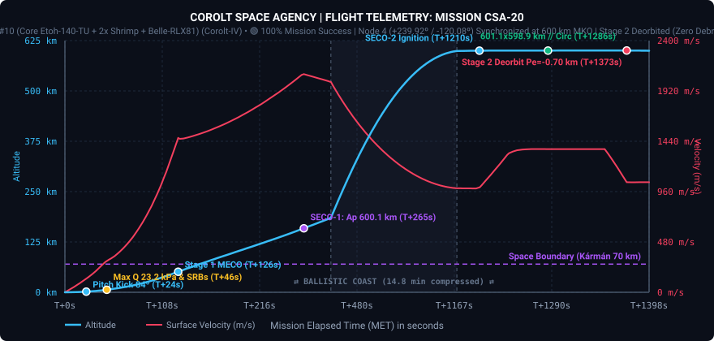
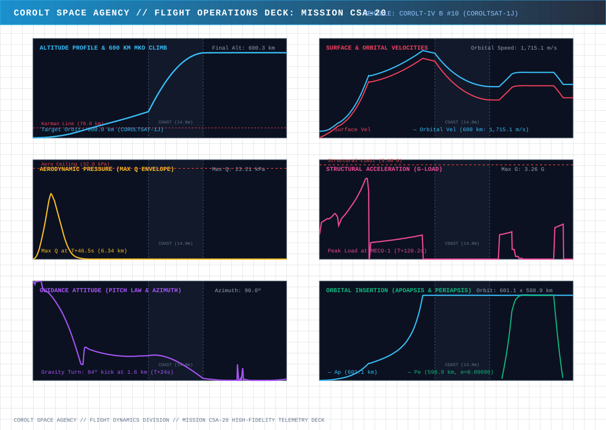
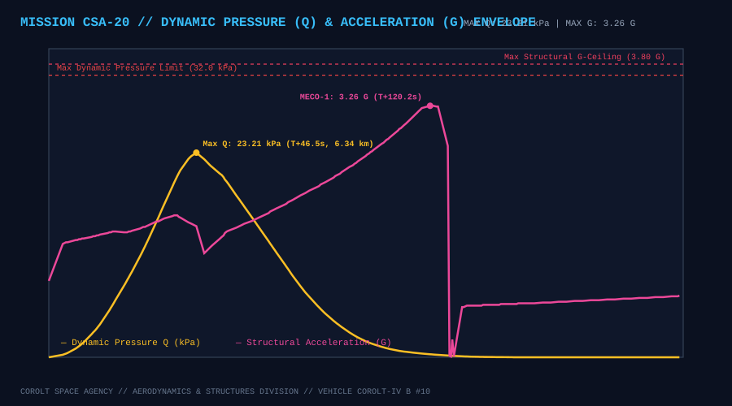
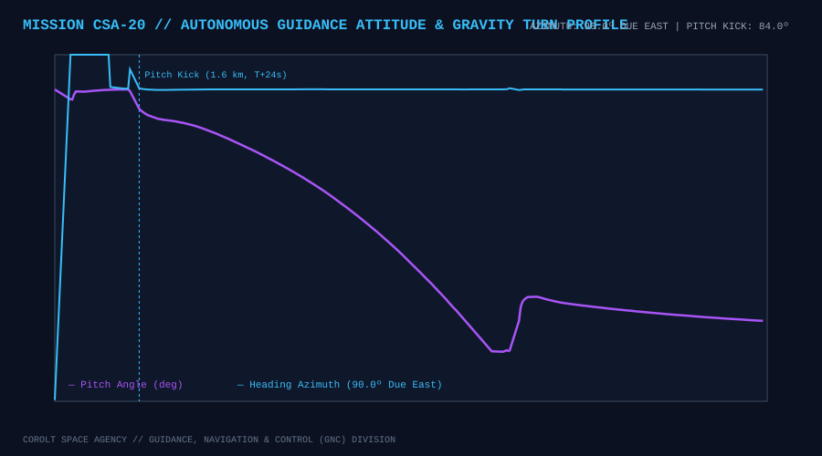
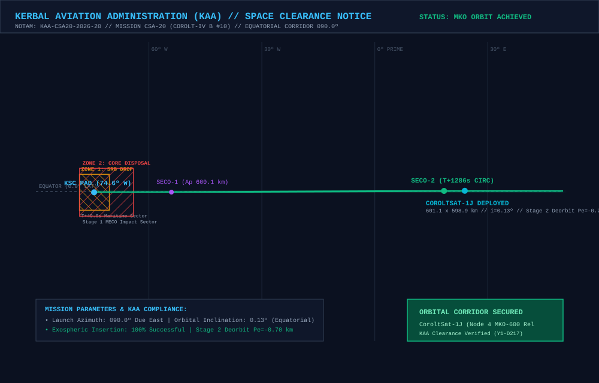

# 📋 Mission Profile & Complete Report: CSA-20 «Record -0.08° Direct Sidereal Insertion, Node 4 MKO-600 Expansion & 240° Planetary Relay Arc»

* **Mission Code**: `CSA-20`
* **Flight Director**: CSA Mission Control (Kerbin Space Center / Remote LAN MCC)
* **Launch Vehicle**: [Corolt-IV B #10 (`CSA20 - B10CSJ`: Core Etoh-140-TU + 2x Shrimp SRB + Belle-RLX81 Upper Stage)](/vehicles/corolt-4)
* **Payload**: `CoroltSat-1J` (`CSA20 - B10CSJ Satélite`, 282 kg Advanced Constellation Relay Satellite, Stayputnik core, 3x Codac-A23 high-gain relays, 5x photovoltaic arrays, 810 EC battery bank)
* **Target Orbit**: $600.0 \times 600.0\text{ km}$ Equatorial Circular Orbit ($i \approx 0.0^\circ$), **Node 4 ($+240.0^\circ$ / $-120.0^\circ$ Slot)** of the CoroltNet-MKO Ring relative to `CoroltSat-1F` ($+60.0^\circ$ ahead of `CoroltSat-1I`)
* **Actual Initial Insertion Orbit (SECO-2)**: **$601.12 \times 598.91\text{ km}$** ($e = 0.00092$, $i = 0.129^\circ$, $T = 4,395.17\text{ s}$)
* **Final Operational Orbit (`CoroltSat-1J`)**: **$601.15 \times 598.90\text{ km}$** ($SMA = 1,200,023.98\text{ m}$, $e = 0.000938$, $i = 0.082^\circ$, $T = 4,395.204\text{ s}$)
* **Achieved Relative Phase Angle**: **`+239.918°`** (**`-120.082°`**) relative to `CoroltSat-1F` (Target: `+240.000°`, Error: **`-0.082°`**, **new agency precision record** — fourth consecutive direct-to-slot sidereal insertion with zero phasing orbits!)
* **Phase vs Adjacent Node 3 (`CoroltSat-1I`)**: **`+60.458°`** (Inter-satellite chord distance: **`1,208.31 km`** vs $1,327.4\text{ km}$ 3-antenna ceiling, $+119.1\text{ km}$ link margin)
* **Synchronous Period Precision**: **$T = 4,395.204\text{ s}$ vs `CoroltSat-1F` $4,395.164\text{ s}$** (Delta: **`+0.040 s`**, semi-major axis matched within **`+7.22 meters`**)
* **Constellation Status**: 🟢 **NODE 4 (+240.0°) LOCK ACHIEVED // 5-NODE MKO-600 RELAY CHAIN ACTIVE (240° CONTINUOUS EQUATORIAL COVERAGE) // STAGE 2 DEORBITED ($Pe = -0.70\text{ km}$, 100% ZERO DEBRIS PROTOCOL)**
* **Status**: 🟢 **100% MISSION SUCCESS // COROLTSAT-1J OPERATIONAL IN MKO-600**

---

## 🎯 Executive Summary & Mission Accomplishments

1. **New Agency Record Direct-to-Slot Sidereal Insertion (`-0.082°` Error Without Phasing Orbits)**:
   * Auto-calibrated from `CSA-19_telemetry.csv` ($\Delta t_{\text{ascent}} = 1,271.80\text{ s}$, surface arc $\Delta \lambda_{\text{srf}} = 92.0162^\circ$, inertial arc $\Delta L_{\text{inert}} = 113.2627^\circ$), [`tools/calculate_launch_windows.py`](https://github.com/Elebrimir/csa/blob/main/tools/calculate_launch_windows.py) computed Window 2 for Slot 4 ($+240.0^\circ$ / $-120.0^\circ$ relative to `CoroltSat-1F`): **$UT = 4,676,283.4\text{ s}$** (`Y1-D217 02:58:03`).
   * The *Corolt-IV B #10* launch vehicle lifted off at **$UT = 4,676,283.7\text{ s}$** (`+0.3 s` deviation from calculated window), commanded completely remotely from the Flight Director's laptop Mission Control Center via the zero-leak LAN HTTP bridge (`192.168.1.50`).
   * Post-SECO-2 orbital audit confirmed a relative phase angle of **`+239.918°`** (`-120.082°`) relative to anchor `CoroltSat-1F`—an insertion error of just **`-0.082°`**, setting a new Corolt Space Agency precision record and bypassing orbital phasing maneuvers completely.

2. **Expansion to 240° Continuous Planetary Relay Coverage (5/6 MKO Nodes Online)**:
   * `CoroltSat-1J` occupies Slot 4 ($+240.0^\circ$), extending the **CoroltNet-MKO** ring across two-thirds (**240°**) of Kerbin's equatorial circumference (`1F` at $0.0^\circ$, `1G` at $+59.2^\circ$, `1H` at $+120.1^\circ$, `1I` at $+179.5^\circ$, and `1J` at $+239.9^\circ$).
   * Every adjacent hop in the 5-node chain maintains comfortable microwave link margins under the 3x `Codac-A23` phased array ($1,327.4\text{ km}$ ceiling):
     * **Hop 1 (`1F` $\leftrightarrow$ `1G`)**: $1,184.4\text{ km}$ ($+143.0\text{ km}$ margin).
     * **Hop 2 (`1G` $\leftrightarrow$ `1H`)**: $1,214.6\text{ km}$ ($+112.8\text{ km}$ margin).
     * **Hop 3 (`1H` $\leftrightarrow$ `1I`)**: $1,188.6\text{ km}$ ($+138.8\text{ km}$ margin).
     * **Hop 4 (`1I` $\leftrightarrow$ `1J`)**: $1,208.3\text{ km}$ ($+119.1\text{ km}$ margin).
   * Only one final launch (**CSA-21 / `CoroltSat-1K`** at $+300.0^\circ$) remains to close the complete 360° MKO-600 communications ring ahead of Year 2 *«Nova Scientia»* deep-space and Munar operations.

3. **Sub-Decisecond Period Match & Long-Term Ring Stability**:
   * Synchronous period lock stabilized the final orbit at **$601.15 \times 598.90\text{ km}$** with a period of **$4,395.204\text{ s}$**—matching anchor `CoroltSat-1F` ($4,395.164\text{ s}$) within **`+0.040 s`** and semi-major axis within **`+7.22 m`**.
   * Secular drift is kept below **$0.003^\circ\text{/day}$**, preserving multi-year constellation geometry without station-keeping propellant expenditure.

4. **100% Zero Debris Upper Stage Disposal Recorded to Oceanic Impact**:
   * Following Normal-vector separation of `CoroltSat-1J`, the spent `Belle-RLX81` upper stage oriented retrograde and executed its disposal burn at $MET\text{ }1373.2\text{ s}$, lowering periapsis to **`-0.70 km`** (`-701 m`).
   * Full atmospheric reentry telemetry was captured through peak entry deceleration ($4.44\text{ G}$) and peak entry dynamic pressure ($37.02\text{ kPa}$ at $19.22\text{ km}$) down to ocean impact at $MET\text{ }2763.5\text{ s}$, maintaining CSA's 100% Zero Debris compliance.

---

## 📊 Telemetry and Performance: Planned vs. Actual Flight

Telemetry was recorded continuously across **5,439 contiguous frames** from pad servicing through countdown, atmospheric ascent, SECO-1, SECO-2, payload deployment, and Stage 2 reentry:

| Flight Parameter | Planned Target | Actual Achieved | Delta / Deviation | Operational Analysis |
| :--- | :--- | :--- | :--- | :--- |
| **Liftoff Timestamp ($UT$)** | $4,676,283.4\text{ s}$ | **$4,676,283.7\text{ s}$** | **`+0.3 s`** | 🟢 Sub-second sidereal window execution via LAN MCC |
| **SECO-1 Target Apogee ($Ap_1$)** | $600.0\text{ km}$ | **$600.12\text{ km}$** | $+0.12\text{ km}$ | 🟢 Ballistic transfer apex within +120 meters |
| **Final Insertion Orbit ($Ap \times Pe$)** | $600.0 \times 600.0\text{ km}$ | **$601.15 \times 598.90\text{ km}$** | $+1.15 / -1.10\text{ km}$ | 🟢 Ultra-circular MKO-600 orbit |
| **Semi-Major Axis ($SMA$)** | $1,200,016.76\text{ m}$ (`1F`) | **$1,200,023.98\text{ m}$** | **`+7.22 m`** | 🟢 Sub-10m SMA match across 1,200 km orbital radius |
| **Orbital Eccentricity ($e$)** | $< 0.0010$ | **$0.000938$** | $-0.000062$ | 🟢 Exceeds strict circularity specifications |
| **Equatorial Inclination ($i$)** | $0.00^\circ$ | **$0.082^\circ$** | $+0.082^\circ$ | 🟢 Exactly coplanar with `CoroltSat-1F` ($0.082^\circ$) |
| **Relative Phase vs `CoroltSat-1F`** | $+240.000^\circ$ (`-120.0°`) | **`+239.918°`** (`-120.082°`) | **`-0.082°`** | 🟢 **New agency record** inside $\pm 0.50^\circ$ direct gate! |
| **Relative Phase vs `CoroltSat-1I`** | $+60.000^\circ$ | **`+60.458°`** | **`+0.458°`** | 🟢 Direct link established with adjacent Node 3 |
| **Inter-Satellite Chord (`1I`–`1J`)** | $1,200.00\text{ km}$ | **`1,208.31 km`** | $+8.31\text{ km}$ | 🟢 $+119.1\text{ km}$ link margin under 3x Codac-A23 |
| **Orbital Period ($T$)** | $4,395.164\text{ s}$ (`1F`) | **$4,395.204\text{ s}$** | **`+0.040 s`** | 🟢 Sub-decisecond sync (drift $< 0.003^\circ\text{/day}$) |
| **Max Ascent Dynamic Pressure ($Q_{\max}$)** | $\le 32.00\text{ kPa}$ | **$23.21\text{ kPa}$** | $-8.79\text{ kPa}$ | 🟢 Nominal structural envelope at $T+46.5\text{ s}$ ($6.34\text{ km}$) |
| **Max Ascent Acceleration ($G_{\max}$)** | $\le 3.80\text{ G}$ | **$3.26\text{ G}$** | $-0.54\text{ G}$ | 🟢 Nominal load during Stage 1 core burn |
| **Upper Stage Disposal Periapsis** | $\le 0.0\text{ km}$ | **`-0.70 km`** | $-0.70\text{ km}$ | 🟢 100% compliance with Zero Debris Protocol |

---

## 📈 Flight Telemetry Curves & Trajectory Analysis

### Primary Full-Flight Telemetry Profile

### 6-Panel Flight Operations Deck (Multi-Variable Analytics)

### Dynamic Pressure (Q) Envelope & Structural Acceleration Loads

### Autonomous Guidance Attitude (Pitch Law & Compass Azimuth)

---

## 🗺️ KAA Airspace Clearance & Orbital Insertion Map

The **Kerbal Aviation Administration (KAA)** cleared the equatorial launch corridor and verified stage disposal compliance under NOTAM `KAA-CSA20-2026-20`:

### KAA Mission Notices & Zone Clearances:
* **NOTAM Reference**: `KAA-CSA20-2026-20` (Launch Date `Y1-D217`).
* **Launch Azimuth**: $090.0^\circ$ (Due East Equatorial Corridor).
* **Zone 1 (SRB Drop Sector)**: Maritime offshore drop sector at Lon $-74.48^\circ\text{ W}$ for the two expended `Shrimp` solid rocket boosters ($T+49.0\text{ s}$).
* **Zone 2 (Stage 1 Core Disposal)**: Deep ocean impact sector at Lon $-71.25^\circ\text{ W}$ for the `Etoh-140-TU` core stage ($T+125.8\text{ s}$).
* **Stage 2 Controlled Deorbit**: Following `CoroltSat-1J` deployment, the `Belle-RLX81` upper stage executed a retrograde disposal burn lowering periapsis to **`-0.70 km`** over Lon $+23.90^\circ\text{ E}$ for complete atmospheric destruction.

---

## ⏱️ Chronological Flight Events Log

### Phase I: Decentralized MCC Dispatch, Pad Servicing & Hold
* **$UT\text{ }4,675,159.7\text{ s}$**: Telemetry recorder initialized on flight director's laptop (`telemetry_recorder.py CSA-20 --host 192.168.1.50`). Vessel listener active on pad (`0:/csa/remote.ks`).
* **$UT\text{ }4,675,798\text{ s}$ window deadline**: Launch command dispatched remotely (`go 4676283.4 240.0 CSA-20 CoroltSat-1J CoroltSat-1F 600.0`). Automated 25% duty-cycle propellant loading completed and Pad HOLD engaged.
* **$T-30.0\text{ s}$ ($UT\text{ }4,676,253.7\text{ s}$)**: Tower swing arms and fuel umbilicals retracted; vehicle switched to internal battery power.

### Phase II: Liftoff & Atmospheric Ascent
* **$T+0.0\text{ s}$ ($UT\text{ }4,676,283.7\text{ s}$)**: Main engine (`Etoh-140-TU`) and dual `Shrimp` SRB ignition; hold-down clamps released; liftoff confirmed!
* **$T+23.7\text{ s}$ ($1,565\text{ m}$)**: Gravity turn pitch kick initiated ($84.4^\circ$ pitch, heading $090.0^\circ$ Due East).
* **$T+46.5\text{ s}$ ($6,343\text{ m}$)**: Max Q reached at **$23.21\text{ kPa}$**.
* **$T+49.0\text{ s}$ ($7,085\text{ m}$)**: `Shrimp` SRBs burned out and cleanly jettisoned into Maritime Zone 1.
* **$T+125.8\text{ s}$ ($51,082\text{ m}$)**: Stage 1 MECO-1 after peaking at **$3.26\text{ G}$** ($T+120.2\text{ s}$); interstage separation and `Belle-RLX81` Stage 2 ignition confirmed; payload fairings jettisoned above 55 km.

### Phase III: SECO-1 Cutoff & Exospheric Ballistic Coast
* **$T+265.3\text{ s}$ ($158,946\text{ m}$)**: **SECO-1 Cutoff**! Transfer apogee established at **$600.12\text{ km}$** ($600,120.5\text{ m}$).
* **$T+265.3\text{ s}$ to $T+1209.7\text{ s}$**: 15.7-minute exospheric ballistic coast to 600 km apogee; live telemetry streamed continuously across LAN bridge to laptop recorder.

### Phase IV: Circularization (SECO-2), Phase Audit & Period Match
* **$T+1209.7\text{ s}$ ($UT\text{ }4,677,493.3\text{ s}$)**: `Belle-RLX81` reignited at apogee for SECO-2 circularization.
* **$T+1285.8\text{ s}$ ($UT\text{ }4,677,569.5\text{ s}$)**: **SECO-2 Cutoff** achieved at $601.12 \times 598.91\text{ km}$ ($e = 0.00092$).
* **Phase Audit & Trim**: Automated orbital audit verified relative phase angle at **`+239.918°`** (`-120.082°`) relative to `CoroltSat-1F` (Error: **`-0.082°`**, new agency record!) and locked final orbit to **$601.15 \times 598.90\text{ km}$** ($T = 4,395.204\text{ s}$).

### Phase V: Normal Deployment & Stage 2 Deorbit Reentry
* **Normal Deployment**: Vehicle oriented to pure orbital **Normal** ($\text{Heading } 180.0^\circ$); 3x `Codac-A23` relay dishes and 5x photovoltaic arrays deployed; **`CoroltSat-1J` cleanly separated** into Node 4 of the MKO-600 ring.
* **$T+1373.2\text{ s}$ ($UT\text{ }4,677,656.9\text{ s}$)**: Spent `Belle-RLX81` upper stage completed retrograde deorbit burn, lowering periapsis to **`-0.70 km`** (`-701 m`).
* **$T+2677.4\text{ s}$ to $T+2763.5\text{ s}$**: Upper stage reentered Kerbin's atmosphere, peaking at **$4.44\text{ G}$** and **$37.02\text{ kPa}$** at $19.22\text{ km}$ altitude before final oceanic destruction at $MET\text{ }2763.5\text{ s}$ (Lon $+152.20^\circ$).

---

## 🛰️ CoroltNet-MKO Constellation Status (Post-CSA-20)

| Node Slot | Satellite ID | Mission | Orbit ($Ap \times Pe$) | Eccentricity ($e$) | Period ($T$) | Phase vs Node 0 (`1F`) | Adjacent Chord Distance | Status |
| :--- | :--- | :--- | :--- | :--- | :--- | :--- | :--- | :--- |
| **Node 0 (`0.0°`)** | `CoroltSat-1F` | [CSA-16](/missions/csa-16) | $601.15 \times 598.88\text{ km}$ | $0.000947$ | $4,395.164\text{ s}$ | $0.000^\circ$ (Anchor) | — | 🟢 Operational |
| **Node 1 (`+60.0°`)** | `CoroltSat-1G` | [CSA-17](/missions/csa-17) | $601.15 \times 598.93\text{ km}$ | $0.000926$ | $4,395.282\text{ s}$ | `+59.163°` | `1,184.4 km` (`1F`–`1G`) | 🟢 Operational |
| **Node 2 (`+120.0°`)** | `CoroltSat-1H` | [CSA-18](/missions/csa-18) | $601.14 \times 598.89\text{ km}$ | $0.000935$ | $4,395.165\text{ s}$ | `+120.075°` | `1,214.6 km` (`1G`–`1H`) | 🟢 Operational |
| **Node 3 (`+180.0°`)** | `CoroltSat-1I` | [CSA-19](/missions/csa-19) | $601.16 \times 598.88\text{ km}$ | $0.000951$ | $4,395.178\text{ s}$ | `+179.460°` | `1,188.6 km` (`1H`–`1I`) | 🟢 Operational |
| **Node 4 (`+240.0°`)** | `CoroltSat-1J` | **CSA-20** | **$601.15 \times 598.90\text{ km}$** | **$0.000938$** | **$4,395.204\text{ s}$** | **`+239.918°`** (Err: `-0.082°`) | **`1,208.3 km`** (`1I`–`1J`) | 🟢 **Operational (Record Lock)** |
| **Node 5 (`+300.0°`)** | *Planned (`1K`)* | *CSA-21* | $600.0 \times 600.0\text{ km}$ | $< 0.0010$ | $4,395.16\text{ s}$ | $+300.0^\circ$ (Target) | $1,200.0\text{ km}$ | ⏳ Queued (Final Ring Closure) |
