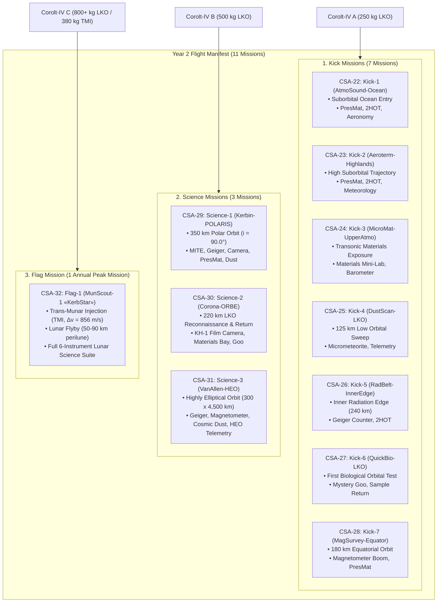
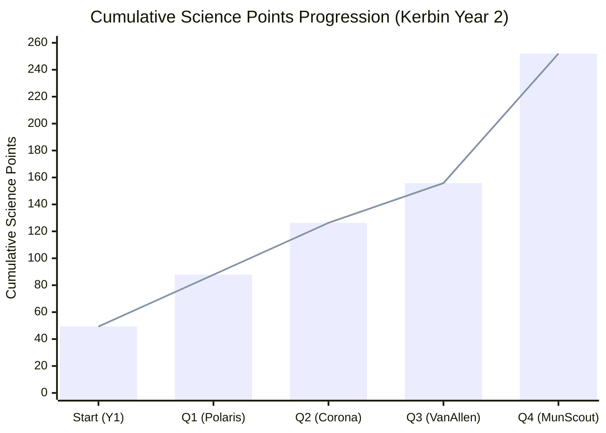

# 🔬 Program «Nova Scientia»: Kerbin Year 2 Science Campaign

> *"Ad Astra Per Scientiam" — To the stars through scientific inquiry.*  
> **Corolt Space Agency (CSA) — Flight Operations & Scientific Planning Directorate**

---

## 🧭 Strategic Mission Architecture & Context

With the operational maturity of the **Corolt-IV modular launch vehicle family** and the ongoing deployment of the high-altitude **CoroltNet-MKO backbone** (600 km, 6 nodes) alongside **CoroltNet-LEO** (300 km), the Corolt Space Agency transitions into its most ambitious exploratory phase: **Kerbin Year 2 (Days 1 to 426)**.

The Year 2 scientific flight manifest introduces a three-tiered mission structure optimized for resource efficiency, scientific yield, and deep-space capability:



---

## 🛠️ Launch Vehicle Allocation (Corolt-IV Family)

The modular Corolt-IV launch system guarantees optimized lift capacity and cost for each tier:

| Vehicle Variant | Propulsion Configuration | Max Payload Capacity | Vacuum $\Delta v$ | Liftoff TWR | Primary Role |
| :--- | :--- | :---: | :---: | :---: | :--- |
| **Corolt-IV A** | • Core: Etoh-140-TU Sandstone (160 kN SL)<br/>• Upper: Belle-RLX81 (FL-T200, 17.2 kN) | **250 kg** to 150 km LKO | **$5,367\text{ m/s}$** | **$1.78$** | **Kick Missions (1 to 3 instruments)**: Rapid construction (~5–6 days in KCT), lightweight suborbital and low-orbital probes. |
| **Corolt-IV B** | • Core: Etoh-140 + 2x Shrimp SRBs (220 kN SL)<br/>• Upper: Belle-RLX81 (FL-T400, 17.2 kN) | **500 kg** to 300 km LKO<br/>**300 kg** to Polar LKO | **$5,392\text{ m/s}$** | **$1.54$** | **Science Missions (2 to 6 instruments)**: High reliability workhorse, multi-restart upper stage, polar injection and heavy recovery capsules. |
| **Corolt-IV C** | • Core: Quad Feldspar Etoh-340-QTU + 4x Shrimp (460 kN SL)<br/>• Upper: Belle-RLX81 (FL-T600, 17.2 kN) | **800+ kg** to 300 km LKO<br/>**380 kg** to Trans-Munar Injection | **$5,506\text{ m/s}$** | **$2.02$** | **Flag Mission**: Heavy deep-space launcher for cislunar injection, high-apogee escape, and multi-payload planetary scouts. |

---

## 🔬 Scientific Instruments & Telemetry Budget (Kerbalism)

All spacecraft systems are designed to operate within Kerbalism telemetry, power consumption, and storage constraints:

| Sensor / Hardware | Experiment ID | Power Draw | Data Rate / Sample | Technical Function |
| :--- | :--- | :---: | :---: | :--- |
| **PresMat Barometer** (`sensorBarometer`) | `barometerScan` | $0.05\text{ EC/s}$ | $0.0038\text{ MB/s}$ | High/low atmospheric pressure gradient and vacuum threshold detection. |
| **2HOT Thermometer** (`sensorThermometer`) | `temperatureScan` | $0.002\text{ EC/s}$ | $0.0033\text{ MB/s}$ | Thermal flux across solar terminator and atmospheric boundary layers. |
| **Aeronomy Sensor** (`SR_Payload_04`) | `SRExperiment02` | $0.50\text{ EC/s}$ | $0.0167\text{ MB/s}$ | Upper atmosphere molecular ionization and aeronomic composition. |
| **Meteorological Bay** (`SR_Payload_03`) | `SRExperiment01` | $0.20\text{ EC/s}$ | $0.0031\text{ MB/s}$ | Atmospheric turbulence and localized surface weather patterns. |
| **Materials Mini-Lab** (`SR_Payload_01`) | `mobileMaterialsLab` | $2.04\text{ EC/s}$ | 4 Samples ($2.48\text{ MB/s}$) | Autonomous material degradation under vacuum and cosmic radiation; high sample yield. |
| **Geiger Counter** (`kerbalism-geigercounter`) | `geigerCounter` | $0.005\text{ EC/s}$ | $0.0010\text{ MB/s}$ | Van Allen radiation belt mapping and cosmic ray flux. |
| **Micrometeorite Detector** (`bluedog_Micrometeorite`) | `logmmImpacts` | $0.001\text{ EC/s}$ | $0.0010\text{ MB/s}$ | Particle impact frequency in orbital space. |
| **Polar Ionosphere Probe** (`probeCoreSphere_v2`) | `kerbalism_MITE` | $0.085\text{ EC/s}$ | $0.0043\text{ MB/s}$ | Auroral electrojet and polar magnetospheric interaction ($70^\circ \le i \le 120^\circ$). |
| **Magnetometer Boom** (`bluedog_Pioneer6_Magnetometer`) | `magnetometer` | $0.20\text{ EC/s}$ | $0.0036\text{ MB/s}$ | Dipole strength and magnetopause bow shock detection (`gptt_mag1`). |
| **Mystery Goo Canister** (`restock-goocanister-625-1`) | `mysteryGoo` | $0.18\text{ EC/s}$ | 2 Samples ($0.67\text{ MB/s}$) | Biological response to space environment and cosmic rays (`gptt_scienceBio`). |
| **Low-Tech Recon Camera** (`bluedog_cameraLowTech`) | `bd_camera` | $0.10\text{ EC/s}$ | $0.1333\text{ MB/s}$ | Digital optical photography of surface biomes. |
| **KH-1 "Bloodhound" Camera** (`bluedog_Keyhole_Camera_KH1`) | `bd_mapping` | $0.05\text{ EC/s}$ | 1 Physical Film Reel | High-resolution wet-film reconnaissance mapping; requires `bluedog_Corona_Pod` recovery. |

---

## 📋 Comprehensive Flight Manifest — Kerbin Year 2

### Tier 1: Kick Missions (7 Flights)

```text
  KICK MISSIONS OPERATIONAL CONCEPT
  Fast build turnaround (~5 days) -> Low mass (< 250 kg) -> Targeted science yield -> Swift deorbit or splashdown
```

#### 1. CSA-22: Kick-1 — `AtmoSound-Ocean`
* **Launch Vehicle**: Corolt-IV A #2
* **Target Profile**: High suborbital ballistic trajectory ($Ap = 85.0\text{ km}$), splashing down in the Kerbin Ocean ($150\text{ km}$ east of KSC).
* **Payload Package (145 kg)**: Stayputnik avionics, PresMat Barometer, 2HOT Thermometer, Aeronomy Sensor Array.
* **Target Science**: Ocean surface/splashed data (`barometerScan@Water`, `temperatureScan@Water`, `SRExperiment02@Water`).
* **Mission Lifetime**: 30 minutes; direct telemetry dump to *CoroltNet-LEO*.

#### 2. CSA-23: Kick-2 — `Aeroterm-Highlands`
* **Launch Vehicle**: Corolt-IV A #3
* **Target Profile**: Inland parabolic arc reaching $Ap = 92.0\text{ km}$ over the Highlands/Grasslands boundary.
* **Payload Package (152 kg)**: Stayputnik avionics, PresMat Barometer, 2HOT Thermometer, Meteorological Survey Package.
* **Target Science**: Low-atmosphere boundary layers over Highlands and Grasslands biomes.
* **Mission Lifetime**: 40 minutes; parachute descent and safe land recovery.

#### 3. CSA-24: Kick-3 — `MicroMat-UpperAtmo`
* **Launch Vehicle**: Corolt-IV A #4
* **Target Profile**: Hypersonic upper atmosphere arc ($Ap = 68.0\text{ km}$, velocity $1,850\text{ m/s}$ through the $50 - 65\text{ km}$ mesosphere).
* **Payload Package (185 kg)**: Aerodynamic nosecone, Materials Study Mini-Lab (`SR_Payload_01`), PresMat Barometer, heat shield, parachute.
* **Target Science**: Harvest pending upper-atmosphere materials exposure (+9.53 science points).
* **Mission Lifetime**: 45 minutes; ballistic reentry and recovery.

#### 4. CSA-25: Kick-4 — `DustScan-LKO`
* **Launch Vehicle**: Corolt-IV A #5
* **Target Profile**: Low Kerbin Orbit insertion ($125.0 \times 125.0\text{ km}$, $i = 0.0^\circ$).
* **Payload Package (160 kg)**: Stayputnik core, Micrometeorite Detector, Telemetry transmitter, 2x battery banks.
* **Target Science**: Orbital dust density and low-altitude debris flux (`logmmImpacts@InSpaceLow`).
* **Mission Lifetime**: 4 orbits (~3.2 hours); passive aerodynamic decay and burnup.

#### 5. CSA-26: Kick-5 — `RadBelt-InnerEdge`
* **Launch Vehicle**: Corolt-IV A #6
* **Target Profile**: Elliptical orbit ($110.0 \times 240.0\text{ km}$, $i = 15.0^\circ$).
* **Payload Package (170 kg)**: Radek-716 Geiger Counter, 2HOT Thermometer, high-bandwidth radio.
* **Target Science**: Sampling the lower fringe of Kerbin's inner radiation belt.
* **Mission Lifetime**: 8 orbits (~6.5 hours); Stage 2 deorbit burn to maintain Zero Debris Protocol.

#### 6. CSA-27: Kick-6 — `QuickBio-LKO`
* **Launch Vehicle**: Corolt-IV A #7 (Following R&D unlock of `gptt_scienceBio`).
* **Target Profile**: Circular $140.0 \times 140.0\text{ km}$ orbit with immediate retrograde entry burn on Orbit 2.
* **Payload Package (210 kg)**: Re-entry capsule, Mystery Goo Canister, heatshield, parachute.
* **Target Science**: First biological microgravity exposure in agency history with specimen recovery.
* **Mission Lifetime**: 1.5 orbits (~1.2 hours); targeted ocean splashdown off KSC.

#### 7. CSA-28: Kick-7 — `MagSurvey-Equator`
* **Launch Vehicle**: Corolt-IV A #8 (Following R&D unlock of `gptt_mag1`).
* **Target Profile**: Circular $180.0 \times 180.0\text{ km}$ equatorial orbit ($i = 0.0^\circ$).
* **Payload Package (190 kg)**: Pioneer-6 folding magnetometer boom, PresMat sensor, dual solar arrays.
* **Target Science**: Baseline measurement of equatorial magnetic dipole inclination and field strength.
* **Mission Lifetime**: 24 hours nominal (passive lifetime indefinite).

---

### Tier 2: Science Missions (3 Flights)

```text
  SCIENCE MISSIONS OPERATIONAL CONCEPT
  Standard Workhorse (Corolt-IV B) -> Multi-instrument bays -> Solar-powered extended life -> Unexplored physical regimes
```

#### 1. CSA-29: Science-1 — `Kerbin-POLARIS` (Global Polar Environmental Observatory)
* **Launch Vehicle**: **Corolt-IV B #9** (Core Etoh-140-TU + 2x Shrimp Boosters + Belle-RLX81 Upper Stage).
* **Target Orbit**: **$350.0 \times 350.0\text{ km}$ True Polar Orbit ($i = 90.00^\circ$, $T = 2,985\text{ s}$)**.
* **Payload Mass**: **$420\text{ kg}$** heavy environmental platform.
* **Subsystems**: 4x NearFuture curved solar arrays, 520 EC battery reserve, 3-axis reaction wheels, kOS polar autopilot.
* **Scientific Suite (5 Instruments)**:
  1. **Ionospheric Polar Cusp Sensor (`kerbalism_MITE`)**: Unlocks the polar auroral dataset ($70^\circ \le i \le 120^\circ$).
  2. **Radek-716 Geiger Counter**: Monitors solar proton entry along open polar magnetic field lines.
  3. **Universal Storage PresMat & 2HOT (`dmUSPresTemp`)**: Atmospheric density over changing latitudes.
  4. **Micrometeorite Detector (`bluedog_Micrometeorite`)**: Multi-angle interplanetary particle flux.
  5. **Low-Tech Multispectral Camera (`bluedog_cameraLowTech`)**: First orbital optical survey of the **Ice Caps**, **Tundra**, **Northern Shelf**, and desert biomes.
* **Operational Lifetime**: **150+ Kerbin days**; permanent relay of telemetry through *CoroltNet* cross-links.

#### 2. CSA-30: Science-2 — `Corona-ORBE` (Orbital Reconnaissance & Sample Return Capsule)
* **Launch Vehicle**: **Corolt-IV B #10**.
* **Target Orbit**: **$220.0 \times 220.0\text{ km}$ Equatorial Insertion ($i = 0.1^\circ$)**.
* **Payload Mass**: **$485\text{ kg}$** composite orbital service module and detachable reentry capsule (`bluedog_Corona_Pod`).
* **Scientific Suite (4 Instruments + Recovery)**:
  1. **SG-1 "Bloodhound" KH-1 Film Camera (`bluedog_Keyhole_Camera_KH1`)**: Exposes physical film over daylight equatorial passes for high-resolution photogrammetric mapping (`bd_mapping`).
  2. **Materials Study Mini-Lab (`SR_Payload_01`)**: Full orbital microgravity exposure of material test specimens (`mobileMaterialsLab@KerbinInSpaceLow`, $+7.77\text{ pts}$).
  3. **Mystery Goo Observation Bay (`GooExperiment`)**: High-altitude biological response canister.
  4. **Avionics & High-G Entry Recorder (`SR_ProbeCore`)**: Dynamic reentry telemetry logging.
* **Operational Lifetime**: **15 Kerbin days** in orbit, followed by timed retrograde burn and soft parachute touchdown on KSC grasslands.

#### 3. CSA-31: Science-3 — `VanAllen-HEO` (Magnetospheric & Radiation Sentinel)
* **Launch Vehicle**: **Corolt-IV B #11**.
* **Target Orbit**: **Highly Elliptical Orbit (HEO): $300.0 \times 4,500.0\text{ km}$ ($e = 0.697$, $i = 28.5^\circ$, $T = 3.65\text{ hours}$)**.
* **Payload Mass**: **$390\text{ kg}$** radiation-hardened magnetospheric probe.
* **Scientific Suite (5 Instruments)**:
  1. **High-Range Geiger Counter (`kerbalism-geigercounter`)**: Measures `geigerCounter@KerbinInSpaceHigh` (+6.00 science points).
  2. **Tri-Axial Magnetometer Boom (`bluedog_Pioneer6_Magnetometer`)**: High-altitude magnetopause boundaries and solar wind bow shock detection.
  3. **Cosmic Dust Detector (`bluedog_GATV_MMDetector`)**: High-apogee dust flux.
  4. **Exospheric Thermal Sensor (`sensorThermometer`)**: Deep-space thermal equilibrium.
  5. **Long-Range Directional Dish (`nfex-antenna-top-dish-1`)**: Direct microwave cross-link into the *CoroltNet-MKO* backbone (600 km).
* **Operational Lifetime**: **200+ Kerbin days** (continuous long-term magnetospheric sentinel).

---

### Tier 3: Flag Mission (1 Annual Flight)

```text
  FLAG MISSION OPERATIONAL CONCEPT
  Heavy High-Energy Launcher (Corolt-IV C) -> Trans-Munar Injection (TMI) -> Lunar Flyby (50-90 km) -> Historic Deep-Space Return
```

#### CSA-32: Flag-1 — `MunScout-1 «KerbStar»` (Inaugural Lunar Exploration Probe)

* **Mission Designation**: `CSA-32` / `Flag-1`
* **Launch Vehicle**: **Corolt-IV C #1** (Quad Feldspar Etoh-340-QTU + 4x Shrimp Boosters + Extended Belle-RLX81 Upper Stage; Liftoff Mass: **$23.23\text{ t}$**, Liftoff Thrust: **$460.0\text{ kN}$**, Vacuum $\Delta v$: **$5,506\text{ m/s}$**).
* **Spacecraft Mass**: **$365.0\text{ kg}$** dedicated deep-space probe.
* **Flight Trajectory & Astrodynamics**:
  1. **LKO Parking Insertion**: $180.0 \times 180.0\text{ km}$ circular orbit ($\Delta v_{\text{ascent}} = 4,310\text{ m/s}$).
  2. **Trans-Munar Injection (TMI)**: Belle-RLX81 reignition at lunar nodal alignment ($\Delta v = 856.4\text{ m/s}$), establishing a lunar transfer orbit with perilune altitude $h_p \approx 65\text{ km}$.
  3. **Cislunar Coast**: 16.2 hours of trans-lunar flight with active telemetry downlink to *CoroltNet-MKO*.
  4. **Perilune Science Encounter**: Hyperbolic swing around the Mun's leading hemisphere, harvesting lunar close-approach observations before bending into an eccentric Kerbin return trajectory.
* **Comprehensive Scientific Suite (6 Instruments)**:
  1. **Lunar Optical Reconnaissance Camera (`bluedog_cameraLowTech` / `Codac LO-2180`)**: High-resolution photography of lunar craters, maria, and the far side (`bd_camera@MunInSpaceLow` & `bd_camera@MunInSpaceHigh`).
  2. **Cislunar Magnetometer Boom (`bluedog_Pioneer6_Magnetometer`)**: High-sensitivity search for lunar crustal magnetic anomalies and interplanetary magnetic field interaction.
  3. **Cosmic Ray & Radiation Counter (`kerbalism-geigercounter`)**: Interplanetary radiation levels outside Kerbin's magnetosphere and near the lunar surface.
  4. **Deep-Space Micrometeoroid Detector (`bluedog_Micrometeorite`)**: Cislunar impact rate.
  5. **Space Environment Temperature Sensor (`sensorThermometer`)**: Thermal drop during lunar occultation and eclipse.
  6. **Deep-Space Materials Exposure Bay (`SR_Payload_01`)**: Long-term material resilience in the unshielded lunar environment.
* **Anticipated Scientific Yield**: **`+95 to +115 science points`** in a single mission, inaugurating CSA's deep-space and lunar era.

---

## 📅 Kerbin Year 2 Production & Launch Calendar (426 Days)

```text
Quarter 1 (Days 1 to 100):
• Day 12:  CSA-22 (Kick-1: AtmoSound-Ocean)      [Corolt-IV A] -> Ocean entry
• Day 38:  CSA-23 (Kick-2: Aeroterm-Highlands)   [Corolt-IV A] -> Highlands descent
• Day 65:  CSA-24 (Kick-3: MicroMat-UpperAtmo)   [Corolt-IV A] -> Upper atmo recovery
• Day 92:  CSA-29 (Science-1: Kerbin-POLARIS)    [Corolt-IV B] -> Polar insertion (90°)

Quarter 2 (Days 101 to 200):
• Day 125: CSA-25 (Kick-4: DustScan-LKO)         [Corolt-IV A] -> LKO dust survey
• Day 155: CSA-26 (Kick-5: RadBelt-InnerEdge)    [Corolt-IV A] -> Inner radiation sweep
• Day 185: CSA-30 (Science-2: Corona-ORBE)       [Corolt-IV B] -> Film reconnaissance & return

Quarter 3 (Days 201 to 300):
• Day 225: CSA-27 (Kick-6: QuickBio-LKO)         [Corolt-IV A] -> Mystery Goo orbital test
• Day 255: CSA-28 (Kick-7: MagSurvey-Equator)    [Corolt-IV A] -> Magnetometer survey
• Day 285: CSA-31 (Science-3: VanAllen-HEO)      [Corolt-IV B] -> Highly elliptical orbit

Quarter 4 (Days 301 to 426):
• Day 345: Rollout & FRR for Flag Mission
• Day 355: CSA-32 (Flag-1: MunScout-1 «KerbStar»)[Corolt-IV C] -> Trans-Munar Injection (TMI)
• Day 356: Lunar encounter (Perilune 65 km) & cislunar science campaign
• Days 360-426: Telemetry post-processing, sample analysis, and Year 3 mission planning
```

---

## 📈 R&D Unlocks Roadmap & Cumulative Science Growth



* **Immediate Unlocks (Start of Y2)**:
  * `gptt_scienceBio` (**20 pts**): Unlocks Mystery Goo containers (`GooExperiment`, `restock-goocanister-625-1`) for Kick-6 and Science-2.
  * `gptt_mag1` (**30 pts**): Unlocks precision magnetometer booms for Kick-7, Science-3, and Flag-1.
* **Mid-Year Unlocks (Q2-Q3)**:
  * `gptt_sciRad1` (**40 pts**): Ion chambers and advanced radiation spectrometers.
  * `gptt_solidVac0` (**8 pts**): Compact solid apogee kick motors.
  * `gptt_mono1` (**20 pts**): Monopropellant RCS thrusters and fine attitude maneuvering.
* **Post-Flag Mission Unlocks (Q4)**:
  * `gptt_comm3` (**40 pts**) & `gptt_solar2` (**80 pts**): Interplanetary high-gain dishes and deployable solar arrays for Kerbin Year 3 planetary exploration.
